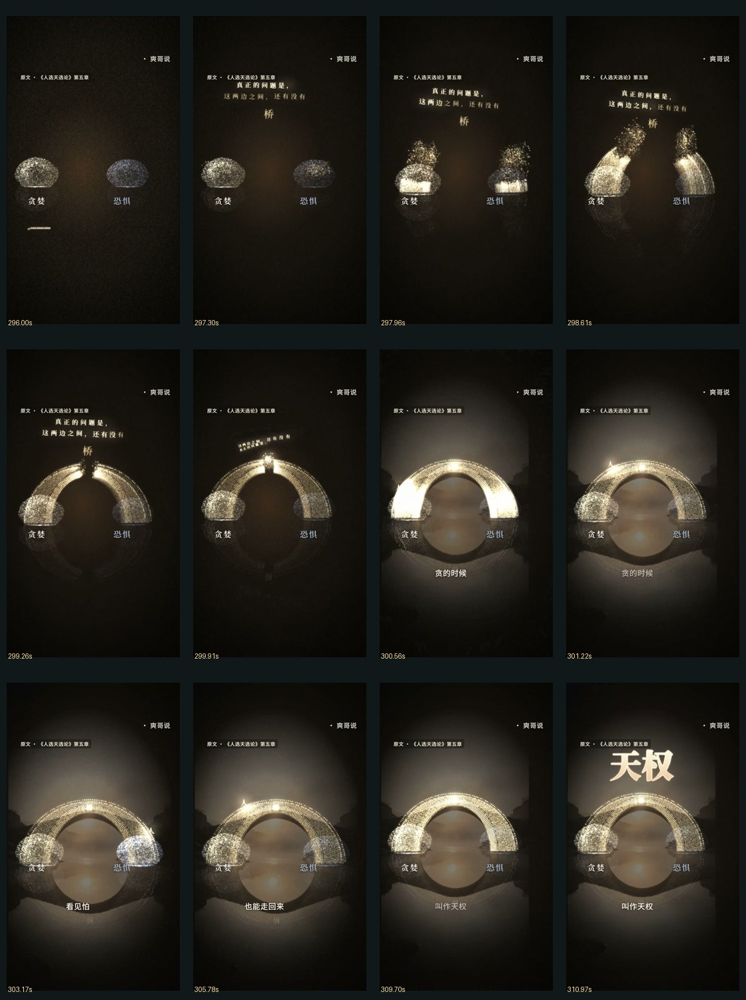
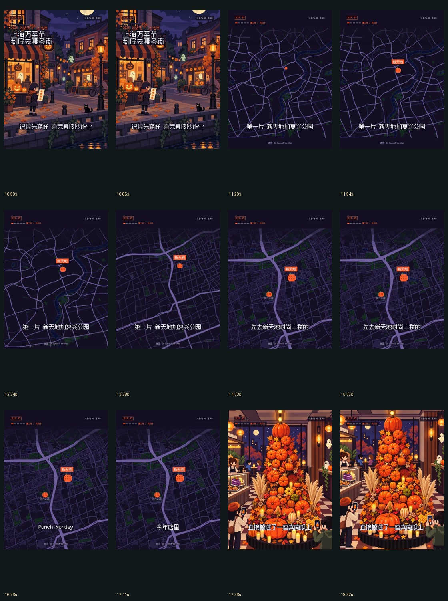
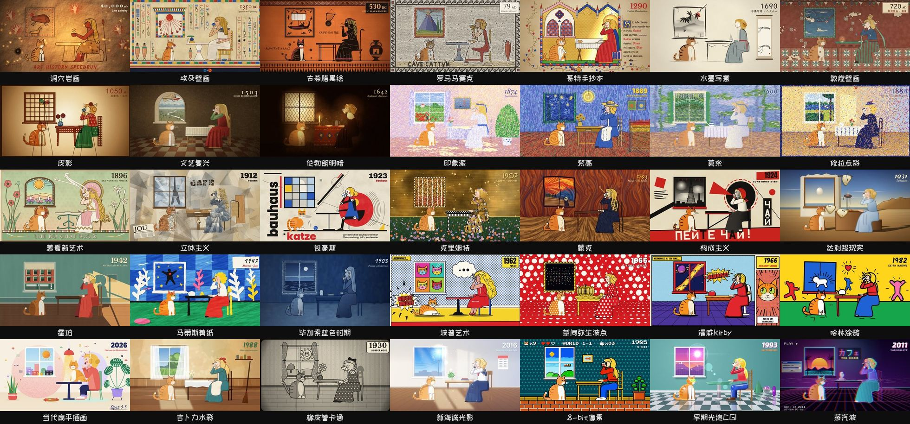
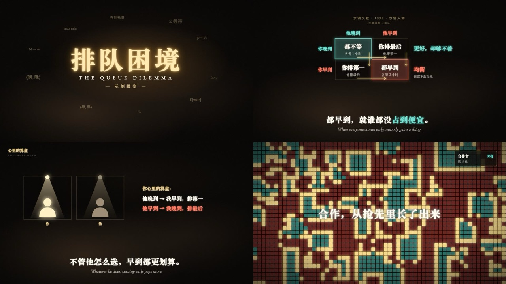
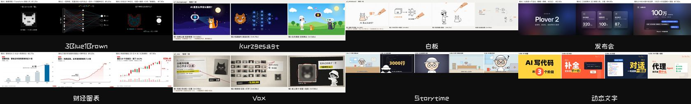
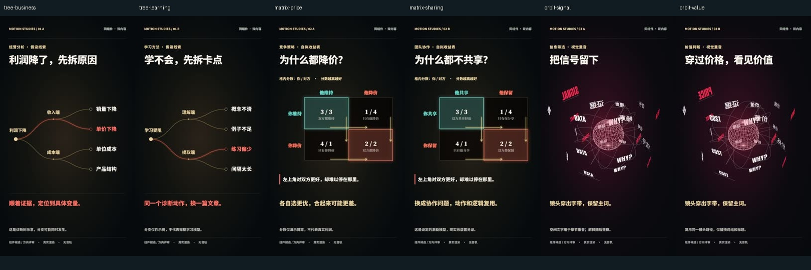

# Script to Video · 视觉素材库与制作档案

> **2026-10-29：用户已否决本版：动画不流畅，主要仍是背景图推拉、字幕/纸卡叠加和人物贴纸位移；不作为已验证的成片路线。**

**LifeOS 路线的实际制作分支：[像素街区双画幅成片与三个连续实验](examples/pixel-scene-map/index.html)**。105.57秒固定凯撒稿，六张完整环境、独立人物/前景/道具、地图与相机配置；另有24秒第二内容在干净目录的复现测试。[可执行入口与边界](references/pixel-scene-map.md)。参考媒体现已按需提供；本版尚不代表1:1审美通过。

**2026-10-29 新增：[139条样片索引](https://ninglinliu.github.io/script-to-video-skill/examples/reference-study-20261029/) · [爽哥说 / LifeOS 两条参考与8段动作拆解](https://ninglinliu.github.io/script-to-video-skill/examples/reference-study-20261029/study.html)。** 139条记录现均有在线MP4与真实封面；新增8段原尺寸/30fps关键片段、96张动作帧、28组三帧观察。支持0.5×/0.25×播放、逐帧步进、阶段循环和直接下载。全片网页副本降低体积但不截短；关键片段保留原尺寸。新增28段观察、[制作路径](references/reference-study-20261029/production-route.txt)和[结构化计划](references/reference-study-20261029/plan.json)；参考分析已完成相应抽样，1:1制作尚未验证。

```sh
python scripts/reference_study.py show --route particle-document
python scripts/reference_study.py show --route pixel-scene-map
# 直接取得实际MP4、帧序列和动作阶段，验证哈希；完整clone时复用仓库文件
python scripts/reference_study.py fetch --route particle-document --output ./reference-cache
python scripts/reference_study.py fetch --route pixel-scene-map --output ./reference-cache
# 可加 --all-clips 取得该路线全部关键段，或 --full 取得全片网页副本
```

| 粒子与实体连续场景 · S3 | 像素场景与地图 · L1 |
| --- | --- |
| [](https://ninglinliu.github.io/script-to-video-skill/examples/reference-study-20261029/study.html#S3) | [](https://ninglinliu.github.io/script-to-video-skill/examples/reference-study-20261029/study.html#L1) |
| [原尺寸静音MP4](https://ninglinliu.github.io/script-to-video-skill/examples/reference-study-20261029/motion/S3.mp4) | [原尺寸静音MP4](https://ninglinliu.github.io/script-to-video-skill/examples/reference-study-20261029/motion/L1.mp4) |

点击图进入可播放、减速、逐帧和阶段循环的对照页。帧图来自实际参考片，不是生成的分镜；复现效果尚待独立制作验证。

分别交给制作 Agent 的完整任务提示词：[A · 凯撒 × 粒子字与连续场景](references/reference-study-20261029/prompts/caesar-particle.txt) · [B · 凯撒 × 像素场景与地图剪辑](references/reference-study-20261029/prompts/caesar-pixel.txt)。两条任务沿用同一份约106秒凯撒改编稿，把动画差异单独比较，并要求成片后固化可执行Skill；B路线在本分支已有成片及可执行交付，A路线的完成状态不由本次B路线测试推断。

这是一个包含制作指令、脚本、素材和案例的 **Agent Skill**，需要能执行工具的 Agent 及视频运行环境。现有案例可复用；新文章的稳定生产、8–10分钟长片和跨模型复现尚未整体验收。详见[任务完成度、环境依赖与换模型说明](references/runtime-and-portability.md)。

**新 Agent 从这里开始：[迁移完整工程并审看整片](references/executable-production.md)。**

新增 **[《泊松过程》可执行制作分支](references/poisson-cinema.md)**：原有背景、人物、字体和实际解释动作一起复用，按新文章的数据与真实配音 cue 改编。支持事件重排、样本归类、窗口移动对齐、符号消去、曲线与逐门筛选，字幕直接烧入；不再只给配色和说明，让 Agent 自己重画。当前支持 1920×1080，跨文章审美与 DeepSeek 独立成功率仍待实测。

```sh
python scripts/start_episode.py --source poisson-cinema --episode ./episodes/new-cinema
```

本分支的[两组测试输入](assets/poisson-cinema/fixtures/)仅验证不同数据能调用同一套动作，不能作为实测旁白或成片通过记录。下方纸面章节入口仍保留。

```sh
python scripts/start_episode.py --source chapter-01 --episode ./episodes/new-film
```

入口直接保留完整案例的字幕、构图、解释镜头、字体和配音时间线，并接入编码字幕像素检查、整片节奏审看。按新内容改编，不再从12秒组件小样扩写默认影片。三个 kit 已降为**组件测试和取材**，旧 `production.py init` 已撤下。

[同一篇《帕累托法则》修改前后对照](https://ninglinliu.github.io/script-to-video-skill/examples/pareto-revision/)：保留原片，展示迁移来源、字幕实际入画及全片审看证据；制作方检查不等于用户审美认可。

**[打开完整在线展厅：43个专题页 →](https://ninglinliu.github.io/script-to-video-skill/examples/gallery/)**

13个制作风格展示 · 35种艺术场景 · 9类解说语法 · 18组历史制作 · 29条历史静音视频，另有第一批6条组件测试与106秒完整章节。16个旧HTML已整理接入；所有网页播放器默认暂停。



> 上图与下方风格图来自 weilanx / huashu-art-motion 的公开代码预览，归原作者；MIT及字体OFL随素材保留。不是我们的重新创作成果。每张图对应的源码、配方与来源已经存进Skill。

**怎么整理：原样保存 → 蒸馏选择规则 → 对照实际渲染。**

- `assets/weilanx/upstream/`：固定提交导出的778个原版文件，包括组件、50余期示例源码、8个工作流、全部README本地图像和配方。原声、实拍和音乐缺项按上游说明保留，不假装整期媒体齐全。
- `assets/weilanx/canvas/`：补齐35个艺术场景的运行库和字体，可单独播放；默认暂停、无音频。
- [选材与接入方法](references/visual-library.md)、[机器目录](assets/weilanx/catalog.json)、[逐文件来源与哈希](assets/weilanx/provenance.json)。一个项目锁定主风格，按比较、分支、传播、证据更新等解释动作选组件。
- [制作档案](https://ninglinliu.github.io/script-to-video-skill/examples/gallery/#films)：保留成功方向与被否决版本；历史片是完整时长的轻量网页副本，本地原文件未覆盖。

## README全部视觉内容 · 制作风格

下方13个展示均可点进专题页，查看完整配方与对应源码。上游有8套独立风格工具包，展示条目数不等于工具包数。

### [黑金光影](https://ninglinliu.github.io/script-to-video-skill/examples/gallery/style-blackgold.html)



矩阵先显示行动与收益，再用箭头解释选择；同一节点进入分支树。

### [战术屏科普](https://ninglinliu.github.io/script-to-video-skill/examples/gallery/style-tactical.html)


在同一空间重演位置、视线和时间差，再接解释图。

### [灯火史话](https://ninglinliu.github.io/script-to-video-skill/examples/gallery/style-lamplight.html)


同一火光从烽燧到城市网格，地理路径逐段点亮。

### [暖纸工作台](https://ninglinliu.github.io/script-to-video-skill/examples/gallery/style-warm-desk.html)


固定工作台保留卡片身份，卡片换位并让步骤条接住进度。

### [网点档案](https://ninglinliu.github.io/script-to-video-skill/examples/gallery/style-halftone.html)


资料依次进入案卷，印章对应论证结果，网点形成遮挡转场。

### [协作剪辑台](https://ninglinliu.github.io/script-to-video-skill/examples/gallery/style-editor-room.html)


群聊触发画布动作，角色沿时间轴移动同一片段。

### [暗金文献](https://ninglinliu.github.io/script-to-video-skill/examples/gallery/style-gilded.html)


年份、文献和逐步绘制的曲线保留稳定对应。

### [暗金音乐短片](https://ninglinliu.github.io/script-to-video-skill/examples/gallery/style-gilded-ep23.html)


锚词在节拍落稳，前一对象接入增长画面。

### [Vox时间长卷](https://ninglinliu.github.io/script-to-video-skill/examples/gallery/style-vox-timeline.html)


时间尺承载照片与事件，相机跟随同一条因果线。

### [Vox硬切拼贴](https://ninglinliu.github.io/script-to-video-skill/examples/gallery/style-vox-cut.html)


按旁白切入承担证据任务的资料画面，再回到解释对象。

### [像素手绘演播室](https://ninglinliu.github.io/script-to-video-skill/examples/gallery/style-pixel-handdrawn.html)


主持角色把注意力交给图解，道具回到同一桌面。

### [矢量手绘](https://ninglinliu.github.io/script-to-video-skill/examples/gallery/style-vector.html)


表情和道具配合旁白动作，固定人物身份贯穿解释。

### [像素贴纸](https://ninglinliu.github.io/script-to-video-skill/examples/gallery/style-pixel-sticker.html)


角色、贴纸和关键词轮流占据注意力中心。

## 艺术场景与解说语法

35种艺术风格：古代与传统、古典油画、印象派与后印象、现代主义、波普与街头、卡通与动画、数字与像素。每种含预览、配方卡、场景代码及播放入口。详见[七组艺术专题](https://ninglinliu.github.io/script-to-video-skill/examples/gallery/art-01.html)。



[科普图解](https://ninglinliu.github.io/script-to-video-skill/examples/gallery/grammar-01.html) · [新闻与数据](https://ninglinliu.github.io/script-to-video-skill/examples/gallery/grammar-02.html) · [节奏与人物](https://ninglinliu.github.io/script-to-video-skill/examples/gallery/grammar-03.html)

## 我们已有的样片和完整片

[泊松过程90秒](https://ninglinliu.github.io/script-to-video-skill/examples/gallery/film-poisson-full.html) · [三个30秒内容实验](https://ninglinliu.github.io/script-to-video-skill/examples/gallery/film-content-lab.html) · [红黑穿梭](https://ninglinliu.github.io/script-to-video-skill/examples/gallery/film-redshift.html) · [价签之外（被否决）](https://ninglinliu.github.io/script-to-video-skill/examples/gallery/film-anchor-art.html) · [消失的25元](https://ninglinliu.github.io/script-to-video-skill/examples/gallery/film-disappearing25.html) · [黄金研究完整版](https://ninglinliu.github.io/script-to-video-skill/examples/gallery/film-gold-full.html) · [指数三分钟](https://ninglinliu.github.io/script-to-video-skill/examples/gallery/film-index-machine.html) · [看行情还是重做决定](https://ninglinliu.github.io/script-to-video-skill/examples/gallery/film-decision-frequency.html)

[完整43页目录](https://ninglinliu.github.io/script-to-video-skill/examples/gallery/)同时包含早期版本、并列对照、真实分镜和原HTML整理版。静帧、组件数量与技术通过都不替代用户对成片的认可。

---

## 新增：106秒完整章节及素材

**[打开《回本以后，什么会改变？》静音预览 →](https://ninglinliu.github.io/script-to-video-skill/examples/chapter-01/)**


从凯撒文章的“成本价陷阱”蒸馏出一个具体问题。两张账单、同一现价依次进入未来路径、回本基数、研究证据与现实反例。**105.57秒，1920×1080，30fps，7段；完整长片质量仍待验证。**

[完整源码与运行说明](examples/chapter-01/README.md) · [配音MP4](examples/chapter-01/out/final-with-audio.mp4) · [静音MP4](examples/chapter-01/out/final-silent.mp4) · [SRT](examples/chapter-01/out/subtitles.srt)

- **可编辑生产素材**：七段干净画面、全片干净画面、独立配音WAV/MP3、真实WordBoundary时间线、OFL字体及许可、有限论文题头引用。
- **五步流程实录**：原文整理、内容蒸馏、脚本核对、跨镜分镜、连续小样与完整章节。附事实证据、对象状态及具体修复记录。
- **长片补充**：章节论证、信息推进、素材分工、对象接力、全局时码、局部重渲；不是把组件串起来就叫长视频。
- **声音工具**：本地混音、旁白避让、响度与峰值检查、视频码流不变核对。用户指定的第三方BGM只在本地版使用，仓库记录来源并支持自行导入；公开有声版保留旁白。

用户已手动验证既有剪映／PR导入、编辑和导出，并要求不重复验证。新文件的实际Agent验证另记；不把XML称作原生工程。素材范围见[来源与许可](NOTICE.md)。

---

## 先看具体动作，再定组件库

**[打开在线可播放对照页 →](https://ninglinliu.github.io/script-to-video-skill/examples/batch-01/)**

页面完整保留双内容对照、来源说明、组件参数与本地选择记录。所有自制小样无音轨、默认暂停。



| 组件 | 示例 A（10 秒 MP4） | 示例 B（10 秒 MP4） | 来源 |
|---|---|---|---|
| 分支生长与路径追踪 | [利润下降](examples/batch-01/out/tree-business.mp4) | [学习受阻](examples/batch-01/out/tree-learning.mp4) | weilanx GoldTree，MIT |
| 收益比较与选择箭头 | [降价竞争](examples/batch-01/out/matrix-price.mp4) | [团队共享](examples/batch-01/out/matrix-sharing.mp4) | weilanx PayoffMatrix，MIT |
| 空间字带与主词落稳 | [信号与噪声](examples/batch-01/out/orbit-signal.mp4) | [价格与价值](examples/batch-01/out/orbit-value.mp4) | 既有 rtiaho 研究版原创代码 |

每组两套内容共用同一动画逻辑。分支树展开原因再沿证据追踪；矩阵先比较收益再显示选择方向；空间字带穿出后停稳主词，用于短促重音。

**[第一批源码与运行说明](examples/batch-01/README.md)** · [六套输入配置](examples/batch-01/src/catalog.ts) · [来源及代码哈希](examples/batch-01/provenance.json) · [技术验证](examples/batch-01/qa/validation.json) · [制作方画面检查](examples/batch-01/qa/producer-review.json)

### 参考的是哪几秒

| 原作 | 时间码 | 借鉴动作 |
|---|---|---|
| [Iwanau · 运气的形状](https://www.douyin.com/video/7690344836800913785) | 3.80–7.20s | 同一实体保留轮廓，变成解释模型；待实现 |
| [Nico · 人生容错率](https://www.douyin.com/video/7697240924837748134) | 8.00–11.20s | 同一节点长出多条路径 |
| [Iwanau · 为什么中杯卖得最好](https://www.douyin.com/video/7692118707825294713) | 1.80–7.20s | 加入选项后改变比较关系；待实现 |
| [rtiaho · memories](https://www.douyin.com/video/7695456829056455158) | 1.70–3.50s | 字带、透视和前后遮挡 |

参考作品仅链接引用。原作视频、截图、配乐不随仓库分发；生成小样不宣称与参考同等质量。

### 当前完成到哪里

- 已完成：3 个组件候选、6 条 1080×1920 / 30 fps / 10 秒渲染、双内容参数配置、来源与许可、技术和局部连续帧检查。
- 已获认可：第一批组件方向；不等于之后所有文章或成片自动通过审美验收。
- 待验证：跨新文章的稳定质量、更多素材类型和8–10分钟长片观看体验。编辑器工作流已有用户手动确认，不再重复验收。
- 程序动画内部在 Remotion 源码中编辑；渲染 MP4 不等于剪映原生动画图层。

---

## Skill 工作流

中文知识视频的 Agent 工作流 Skill：按项目选择视觉、内容形式、时长和剪辑方法，共用证据、资产、时间线与检查方式，由 Agent 在内部制作、检查、修复，再交付配音 MP4、字幕和工程。详见[多样性与项目配置](references/production-profiles.md)。

**提供工作流指令、风格配置、验收器、第一批3组组件与6条小样，以及完整章节的渲染工程、真实配音素材、TTS适配脚本和局部重渲入口。** 外部TTS与渲染运行时按各自条件使用；这不是任意文章自动生成好镜头的确定性程序。 需要与自己的制作工程配合使用；不承诺任意文章首遍完美，也不将技术检测当作审美认可。

## 给下一位Agent的经验入口

[18条决策卡](references/experience/casebook.md)来自已有制作方修复、用户反馈及未解决问题。每条写明：何时使用、先做什么、保留什么、例外、验证与回退、证据范围。不是要求模型通读工作日志。

```sh
python scripts/experience.py select --stage repair --query "字幕孤字，修后更挤"
```

默认最多返回三条相关经验；实际应用见[读取、决策记录与防退步方法](references/experience/usage.md)。检索脚本不调用模型或网络，输出有字符上限；记录检查能抓遗漏，不能证明模型理解或审美正确。

- [显慢的两种原因](references/experience/cards/E01.md)：信息不推进与[动作等待](references/experience/cards/E02.md)分开诊断。
- [字幕修复反而产生孤字行](references/experience/cards/E08.md)：先按最终字体平衡断行，复用不受影响的画面与声音。
- [跨镜对象与问题继承](references/experience/cards/E05.md)：窗口、路径、证据门等实际例子，动作表不替代实现。
- [保留最好版本](references/experience/cards/E11.md)：同区间比较候选，不能因某项改善而接受新的事实或画面错误。
- [验收范围](references/experience/cards/E12.md)：方向认可、制作方抽样和用户整片认可分别记录。

正式制作使用用户选择的高能力主创模型；看图、生成图、配音与渲染能力分别配置。复用已有素材后只补缺口；DeepSeek等模型的移植验证不成为制作前置条件。

## 使用 Skill

将本仓库克隆到 Codex 的 Skill 目录，文件夹命名为 `script-to-video`，例如：

```sh
git clone https://github.com/ninglinLiu/script-to-video-skill.git ~/.codex/skills/script-to-video
```

Windows PowerShell 可将目标目录写成 `$env:USERPROFILE/.codex/skills/script-to-video`。已有同名 Skill 时先比较或备份，不要直接覆盖。其他兼容 Agent 可按自身规则加载根目录 `SKILL.md`。

调用示例：

> 使用 $script-to-video，将这篇文章制作成 60–90 秒竖屏视频。使用我的现有渲染工程，保持固定风格，内部检查并修复字幕与动画衔接，交付 MP4、SRT 和工程。预览静音。

制作方依次完成：原文与证据 → 核心问题与脚本 → 真实配音时间线 → 对象状态与镜头 → 连续小样 → 内部修复 → 成片与验收。

Windows渲染若在`%TEMP%`的`pre-encode.mp4`报`Permission denied`，见[工程临时目录处理方法](examples/chapter-01/README.md#windows临时目录拒绝写入)：在启动渲染前，将当前终端的`TEMP/TMP`指向可写的`工程/.tmp`。

## 默认交付规格

| 模式 | 时长 | 画面 | 其他要求 |
|---|---|---|---|
| `task-short` | 60–90 秒 | 1080×1920，30 fps | 5–8 分镜；H.264 ≥8 Mbps；AAC；SRT；已验证的剪辑工程 |
| `extended` | 165–195 秒 | 1080×1920，30 fps | H.264 ≥8 Mbps；AAC；SRT；剪辑工程单独记录 |
| `chapter-proof` | 90–150秒 | 1920×1080，30fps | CRF质量控制；AAC；SRT；独立分段素材与配音 |

这些是此 Skill 的默认验收配置，不是通用行业标准。用户另有规格时应修改配置及验收器，不能把三分钟扩展版称作短片任务通过。

## 独立使用验收脚本

依赖 Python 3.11+，以及 PATH 中的 FFmpeg / ffprobe；脚本只使用 Python 标准库。无需 API 密钥，不上传文件、不播放声音。

```sh
python scripts/audit_episode.py --episode /path/to/episode --profile task-short --output /path/to/audit.json
```

退出码 `0` 表示脚本所列的技术及记录检查通过，`2` 表示交付不完整。输入损坏、依赖缺失或其他执行错误也可能产生非零退出码。目录、JSON、审稿哈希和记录字段见 [输入协议](references/episode-contract.md)。

验收器检查视频规格、码率、解码、音轨、语音时间戳、字幕区间、稿件与审查哈希、镜头状态及交付记录。它读取已有制作方审查记录，不能独立证明观众满意、实际做过审美审查或编辑器真实导入成功；也不重新判断金融论点或科学事实。

## 仓库内容

- `SKILL.md`：Agent 编排入口与停止条件。
- `references/runtime-and-portability.md`：原任务完成度、模型与Agent职责、运行环境和跨模型验收条件。
- `references/production.md`：固定风格、解释动作和内部审查规则。
- `references/episode-contract.md`：验收器所需的目录和数据协议。
- `assets/style-lock.json`：示例视觉配置；不包含字体文件。
- `scripts/audit_episode.py`：可独立运行的交付验收器。
- `references/long-form.md`：章节论证、跨镜继承、分段生产与尚未验证的范围。
- `references/audio-and-materials.md`：完整音乐辨认、静音混音与素材分发。
- `scripts/mix_music.py`：音乐、配音和已渲染画面的本地混合。
- `examples/chapter-01/`：完整章节、可运行源码、独立素材及审查记录。

第一批组件已完成双内容参数化测试；完整章节经过制作方抽样修复。大规模跨新文章回归及8–10分钟长片质量尚未完成验证，不能由技术通过推出审美通过。参考项目及使用边界见 [NOTICE.md](NOTICE.md)。本仓库原创部分使用 MIT 许可。
