<div align="center">

# Script to Video

### 把一篇文章，变成一段 3D 知识动画

**交给能用工具的 Agent：查证据 → 写稿 → 配音 → 搭 3D 场景 → 逐帧渲染 → 看片修改 → 交付**

    

<a href="https://ninglinliu.github.io/script-to-video-skill/examples/binance-1029/">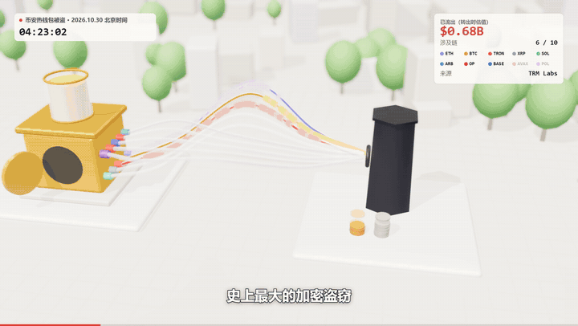</a>

**[▶ 带声音看完整 60 秒](https://ninglinliu.github.io/script-to-video-skill/examples/binance-1029/)** · [分镜总览](#一张图看完一条片) · [架构](#架构总览) · [制作流程](#制作流程) · [组件库](#组件库每个组件都带动作) · [安装](#安装) · [Agent 入口](SKILL.md)

</div>

上面这段动画全部由代码生成：没有素材库、没有 AE、没有手工关键帧。它讲的是 2026 年 10 月币安热钱包被盗时，链上出现的那一小时价差窗口。

**这条样片已获用户认可，是本 Skill 的初版质量基准。** 用户原话："我很满意，符合初版要求。虽然还没达到那两条参考动画的效果，但做到参考效果的五成左右，我就已经比较满意了。"所以它是起点，不是上限。认可也只覆盖这一条 60 秒横屏，[现在做到哪一步](#现在做到哪一步)写了还差什么。

---

## 一张图看完一条片

120 个画面，每 0.5 秒一格，颜色对应旁白的每一句。全部取自实际编码成片，不是概念图。**点开看原图（3962 像素宽）。**

<a href="docs/media/storyboard-binance.jpg">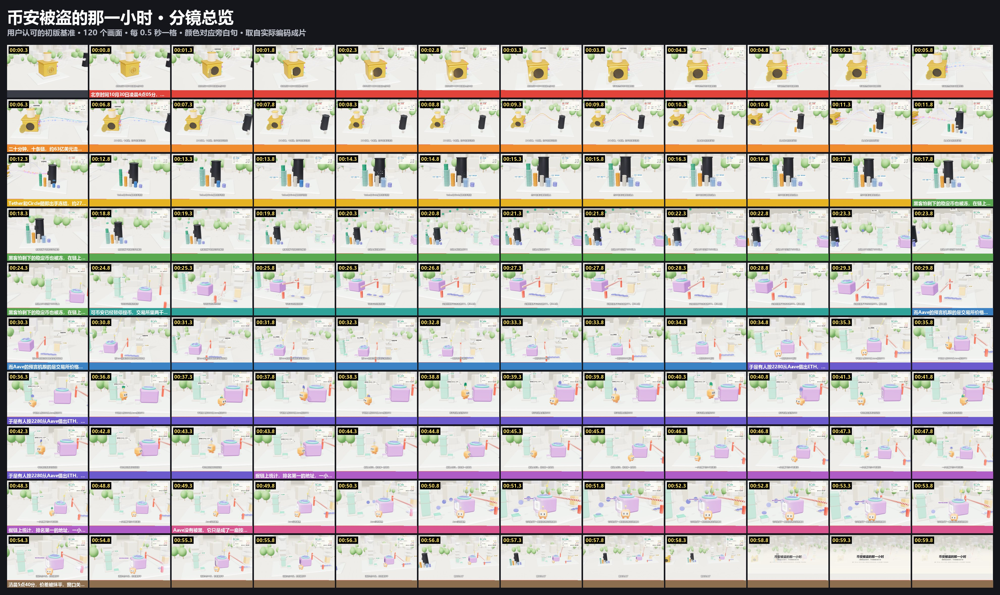</a>

这张图用一条命令就能从任何成片生成，它也是做片时的检查工具：从头到尾扫一遍，哪段画面长得都一样，哪段就有问题。

```sh
python scripts/diorama.py storyboard --video out/final.mp4 --timeline audio/timeline.json --cols 12 --rows 10 --title "片名" --out storyboard.jpg
```

---

## 画面里真的有事发生

历史上被否决的片子，问题几乎都是同一个：**像 PPT，主体不动**。这次的核心改变是让主体一路在做事，结果直接改变画面上的数。

| 十条链依次点亮，资金涌出 | 冰块长出，高度就是冻结比例 |
|:---:|:---:|
| 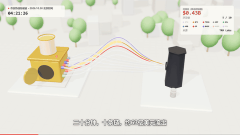 | 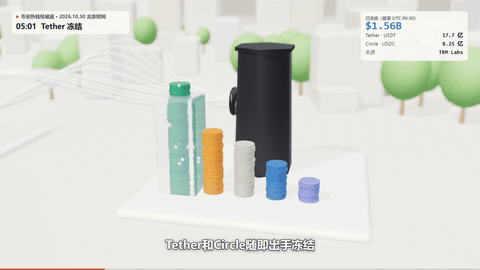 |
| **闸门先蓄力，砸下回弹扬尘** | **小人接币、起跳、卖出、换回** |
| 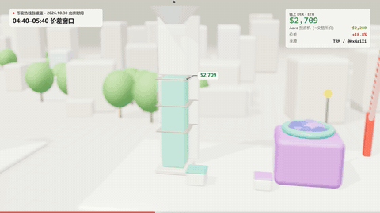 | 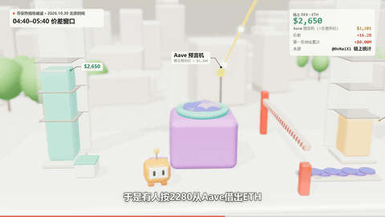 |

下面是八个关键动作的连续帧，每行从左到右是一个动作的完整过程。

<a href="docs/media/atlas-binance.jpg">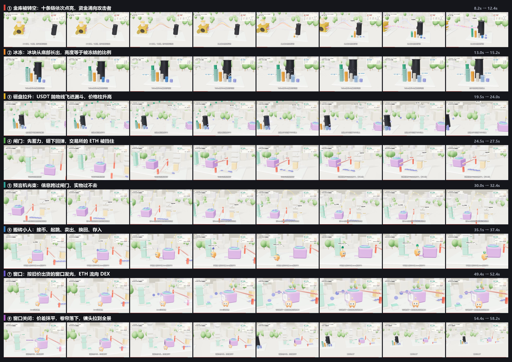</a>

---

## 架构总览

把它理解成一个制作工作室：**模型负责思考，Agent 负责调用工具并根据结果继续工作；harness 是让它能读文件、运行程序、查看画面的工作环境；Skill 是这个工作室的操作手册、工具和材料包。** 换模型时不必重写素材，但要确认环境具备读图、执行代码、渲染的能力。

下图是实际分工。箭头是 Agent 应执行的工作关系，并不表示已有一个无人参与、必定成功的总控程序。

<!-- BEGIN GENERATED: architecture -->
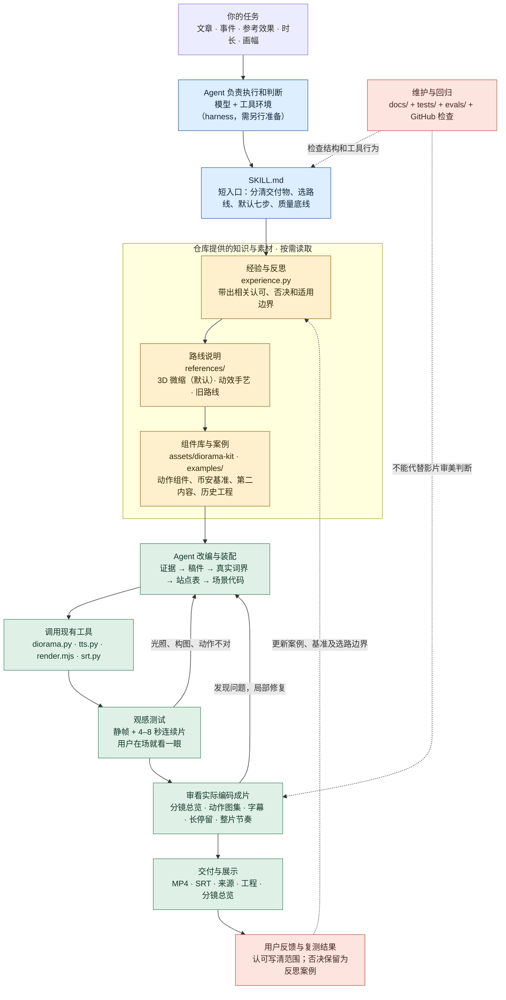
<!-- END GENERATED: architecture -->

### 每一层是什么

| 层 | 文件 | 负责什么 | Agent 什么时候读 |
|---|---|---|---|
| **入口** | [SKILL.md](SKILL.md) | 分清交付物、选路线、默认七步、质量底线。不到 100 行 | 每次都读 |
| **路线** | [diorama-3d](references/diorama-3d.md) · [motion-craft](references/motion-craft.md) | 默认路线怎么走，曲线、时长、错峰、镜头、灯光的具体参数 | 选定路线后 |
| **组件库** | [assets/diorama-kit](assets/diorama-kit/README.md) | 舞台、叠加层、14 个带动作的组件、配音、逐帧渲染 | 搭场景时 |
| **案例** | [币安基准](examples/binance-1029/README.md) · [第二内容](examples/pareto-diorama/README.md) | 完整源码、稿件、时间线、成片、弱点记录 | 要参考或改编时 |
| **工具** | [diorama.py](scripts/diorama.py) | 起工程、查环境、分镜总览、动作图集、动作量、交付检查 | 制作全程 |
| **经验** | [experience.py](scripts/experience.py) · [reflections.json](references/experience/reflections.json) | 23 张经验卡、8 个认可和否决案例，按路线和症状检索 | 遇到具体问题时 |
| **旧路线** | [legacy-workflow](references/legacy-workflow.md) | 纸面章节、泊松空间等旧路线的完整约束 | 走旧路线时 |
| **维护** | [docs/](docs/architecture.md) · [tests/](tests/) · [evals/](evals/README.md) · GitHub 检查 | 结构一致性、工具回归、独立复测任务 | 改 Skill 时 |

**统一的是入口、证据和交付方式；可以变化的是题材、风格、时长和画幅。** 架构图的唯一来源是 [architecture.mmd](docs/architecture.mmd)，由脚本同步进这里；为什么这样改，见[架构说明](docs/architecture.md)。

### 目录怎么找

README 给人看全局，`SKILL.md` 给 Agent 一个短入口，大素材只供程序读取。仓库有多大不等于要把多少东西送进模型：经验命令默认最多返回 3 张卡、6500 字符。

<!-- BEGIN GENERATED: architecture-tree -->
```text
script-to-video-skill/
├── .github/  # 每次 push / PR 的架构一致性与工具检查
├── assets/  # 引擎、组件、字体及素材；供程序使用
│   └── diorama-kit/  # 3D微缩一镜到底套件：动效原语、逐帧渲染、真实词界配音
├── docs/  # 架构、完整树和体积统计；维护时读取
│   └── media/  # README 的图和 GIF，由 build_readme_media.py 从实际成片生成
├── evals/  # 交给独立 Agent 的复测任务；运行结果另行记录
├── examples/  # 完整工程、实际样片、网页展厅；按需取用
│   ├── binance-1029/  # 用户认可的初版基准：源码、成片、分镜、来源
│   ├── pareto-diorama/  # 第二内容验证：只用组件库搭建，用户未看
│   └── reflections/  # 由案例记录生成的静音反思展示页
├── references/  # 按任务选择的规则与路线，不要求全部通读
│   ├── experience/  # 经验卡、反思案例及来源；按阶段和路线检索
│   │   └── reflections.json  # 反思案例的唯一事实源；保留否决状态与证据范围
│   ├── reference-study-20261029/  # 参考片动作拆解、制作路径与独立任务提示词
│   ├── diorama-3d.md  # 默认路线：3D 微缩一镜到底
│   ├── legacy-workflow.md  # 旧版入口全文，旧路线的约束来源
│   └── motion-craft.md  # 动作曲线、错峰、镜头、灯光参数
├── scripts/  # 命令：起工程、出分镜总览、量动作、查交付、取经验、打包
├── tests/  # 确定性的工具回归，不是审美打分
├── AGENTS.md  # 修改本仓库时遵守的约定
├── CONTRIBUTING.md  # 先更新架构、再改内容、提交前检查的步骤
└── SKILL.md  # Agent 的短入口：分清交付物、选路线、默认七步、质量底线
```
<!-- END GENERATED: architecture-tree -->

[完整文件树与体积](docs/repository-tree.md) · [全部路径](docs/repository-tree.txt) · [换模型及环境要求](references/runtime-and-portability.md)

---

## 制作流程

<!-- BEGIN GENERATED: production-flow -->
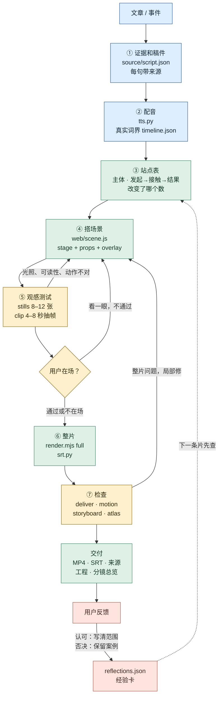
<!-- END GENERATED: production-flow -->

每一步的产物都在工程目录里，下一步直接读：

| 步骤 | 做什么 | 命令 | 产物 |
|---|---|---|---|
| **起工程** | 复制组件库；可从完整案例起步 | `python scripts/diorama.py new --episode ./ep` | 工程目录 |
| **① 证据和稿件** | 事实核对到一手来源，每句写来源。第三方统计在画面上注明 | 人工 + 检索 | `source/script.json` |
| **② 配音** | 逐句合成，保存真实词界。所有动画时间都引用它，改稿后画面自动跟上 | `python tts.py .` | `audio/timeline.json`、`voice.wav` |
| **③ 站点表** | 每句写清"主体、发起 → 接触 → 结果、改变了哪个数、镜头怎么走" | 写在计划里 | 站点表 |
| **④ 搭场景** | 用组件搭，缺什么加进组件库 | 编辑 `web/scene.js` | 场景代码 |
| **⑤ 观感测试** | 静帧修光照和可读性，连续片看动作。用户在场就先看一眼 | `node render.mjs stills 1,8,15`<br>`node render.mjs clip 17 24 --mb 4` | `qa/` |
| **⑥ 整片** | 1080p、4 子帧运动模糊，RTX 4060 约 0.35 秒/帧 | `node render.mjs full --mb 4`<br>`python srt.py .` | `out/final.mp4`、SRT |
| **⑦ 检查** | 规格、解码、字幕、来源、长停留，从头到尾看分镜总览 | `diorama.py deliver` · `motion` · `storyboard` | 检查报告 |

反馈回来后：认可写清范围，否决保留成案例，都记进 [reflections.json](references/experience/reflections.json)，下一条片选路时自动带出来。

<details><summary><b>为什么要先出静帧、再出连续片？看币安样片的五轮观感测试</b></summary>

每轮的问题都是渲出来、看了才发现的。泛光把画面冲白、小人只见侧脸、币凭空出现在头上，这些写多少规则都防不住，只能靠早看。

<a href="docs/media/look-test-rounds.jpg">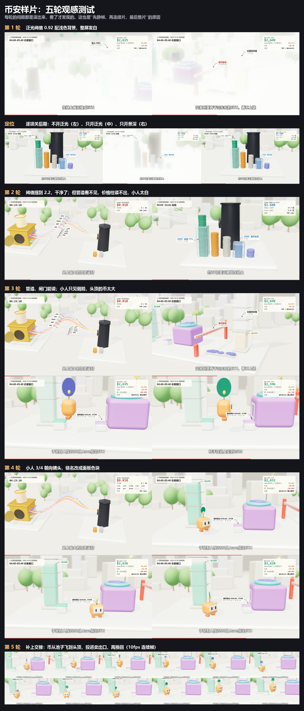</a>

</details>

---

## 组件库：每个组件都带动作

不是一堆好看的模型，而是"一个动作"：闸门会蓄力再砸下，冰块会长出来，币会飞过去。下图由 [catalog.js](assets/diorama-kit/web/catalog.js) 实际渲染，脱离币安内容独立运行。

<a href="docs/media/components.jpg">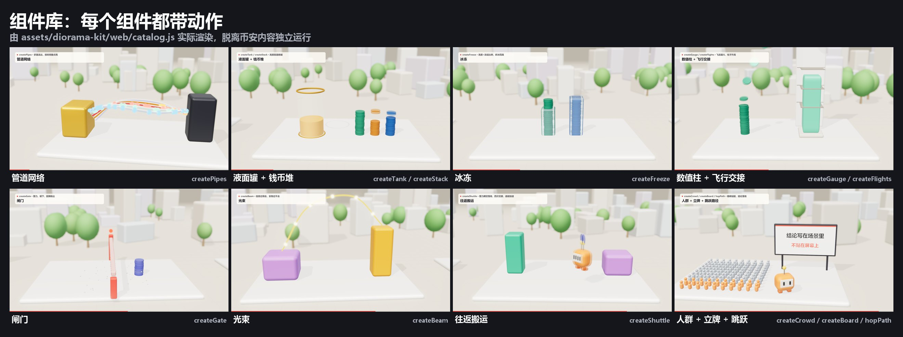</a>

| 组件 | 动作 | 数据怎么进来 |
|---|---|---|
| `createFlights` | 物体从 A 抛物线飞到 B，可数已落地 | 落地数驱动计数和柱高 |
| `createStack` | 钱币一枚枚落下叠高 | 堆高 = 金额 |
| `createPipes` | 多路玻璃管，按时间窗点亮，代币流过 | 每路金额和到达比例 |
| `createTank` | 液面升降 | 液面 = 余额比例 |
| `createFreeze` | 冰块从底部长出，碎冰四溅 | 冰块高度 = 冻结比例 |
| `createGauge` | 带背板和刻度的数值柱 | 柱高 = 数值 |
| `createGate` | 蓄力、砸下、回弹、扬尘、警示灯 | 关闭和打开的时刻 |
| `createBeam` | 光束逐段长出，脉冲持续传递 | 表示信息过得去、实物过不去 |
| `createMascot` | 暖色方块角色，3/4 朝向，挤压拉伸 | 位置、朝向、携带物 |
| `createShuttle` | 往返搬运，四次交接，逐趟加速 | 已完成趟数驱动累计量 |
| `hopPath` | 按落地时刻排一路跳跃 | 时刻、位置、朝向 |
| `createCrowd` | 小人方阵，错峰站起，可变色、升高 | 每个人的状态 |
| `createBoard` | 结论立牌，从上方落下回弹 | 文字行 |
| `createInstances` | 通用实例组：地块、柱阵、豆荚 | 每个实例的位置、大小、颜色 |

底下还有[舞台](assets/diorama-kit/web/stage.js)（景深、泛光、运动模糊、连续镜头）和[叠加层](assets/diorama-kit/web/overlay.js)（跟随 3D 物体的标签、数字面板、按真实词界分行的字幕）。

---

## 动效手艺

"像 PPT"有一个机械定义：**同一曲线、同一时长、同一时刻起止，镜头在关键帧之间停住。** 旧章节工程就是这样：只有一条缓动曲线，所有对象在章节起点同时插值。[motion-craft](references/motion-craft.md) 给的都是能直接用的参数：

| 动作 | 写法 | 时长 |
|---|---|---|
| 落位、出现 | `spring(t, 1.6–2.2, .3–.45)`，过冲一次再稳 | 0.4–0.8 秒 |
| 重物砸下 | 反向蓄力 0.3 秒，再 `spring(t, 1.5, .32)` | 约 0.8 秒 |
| 飞行 | 位置 `inOutSine`，高度 `arc(p, h)`，边飞边转 | 0.9–1.6 秒 |
| 同类对象 | `stagger` 错峰，总跨度是单个动作的 1.5–3 倍 | — |
| 往返动作 | 每趟越来越快：2.1 → 0.86 秒，先看懂再加速 | — |
| 跳跃 | 蓄力压扁、腾空拉长、落地阻尼回弹 | 约 0.5 秒 |
| 镜头 | `track()` 经过关键帧不减速，焦点跟目标走 | 关键帧间 2.5–6 秒 |

**动作量能量化吗？只能量化一半。** 下图是 6 条实际影片的主体区逐帧变化量：

<a href="docs/media/motion-compare.png">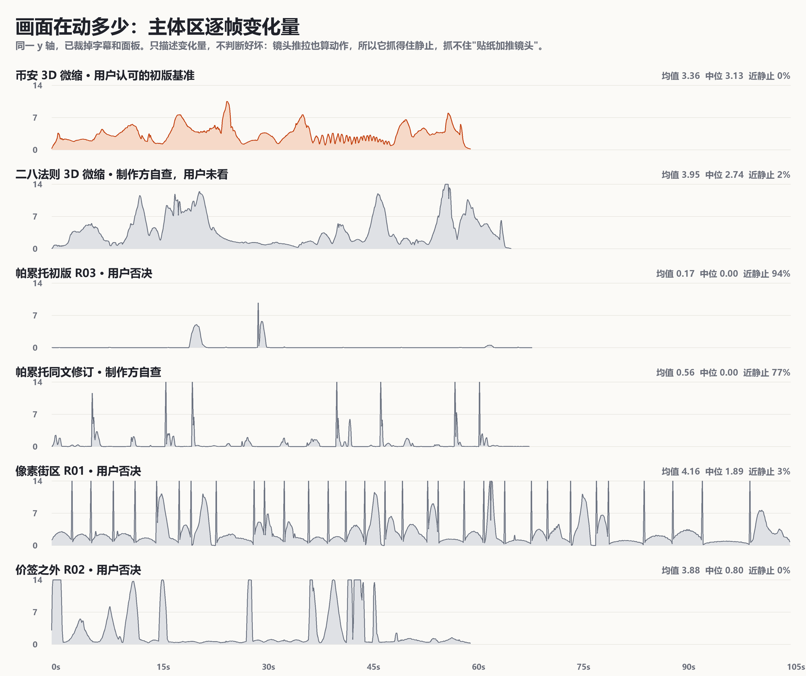</a>

R03 有 94% 的时间不动，一眼就能看出来。但 R01 的均值比币安还高：那些规律的尖刺是硬切，中间的小鼓包是推背景，"贴纸加推镜头"也算动。所以 `diorama.py motion` 只用来提醒去看某一段，**不能当审美分，更不能用来放行**。只有一条认可样本，这些数也不能当阈值。

---

## 换一个题材也能跑

验证方法是不是只能做币安，选了仓库里一篇现成的稿子：《帕累托法则》。它的初版就是被否决的 R03。场景[只用组件库搭建](examples/pareto-diorama/web/scene.js)，没有一行币安专用代码。**这条是制作方自查，用户还没看过。** [▶ 在线播放](https://ninglinliu.github.io/script-to-video-skill/examples/pareto-diorama/)

<a href="docs/media/storyboard-pareto.jpg">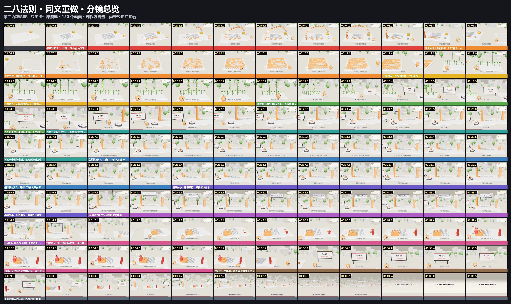</a>

| 小人跳过地块，80% 翻成橙色 | 转动指数 α，分布和份额一起变 |
|:---:|:---:|
| 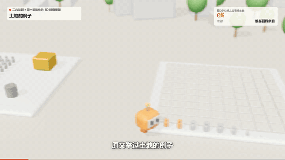 | 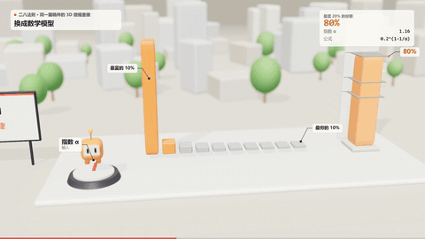 |

同一篇稿子、相同论证节点的三个版本：

<a href="docs/media/same-text-pareto.jpg">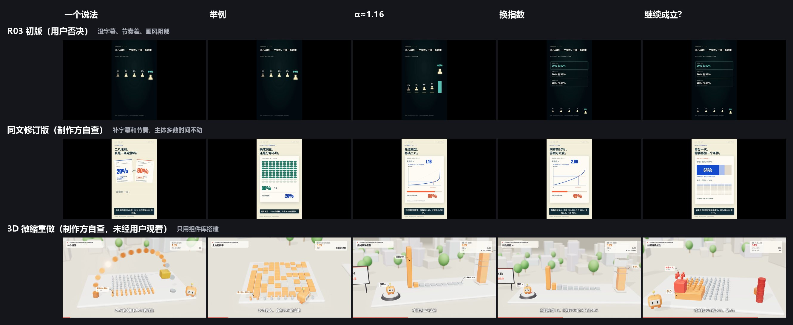</a>

它也暴露了弱点：27–40 秒分镜总览的第 5、6 行几乎一样，镜头基本不动，主要靠柱子变化。[具体记录在这里](examples/pareto-diorama/README.md#观察到的弱点)。

---

## 现在做到哪一步

**工具检查通过、制作方自查、独立 Agent 复测、用户认可，是四种不同的证据**，不互相替代：

| 证据 | 现状 |
|---|---|
| 用户认可 | ✅ 币安 60 秒横屏，初版基准，约为参考效果五成 |
| 制作方自查 | ✅ 币安、二八法则，弱点写在各自的 README |
| 工具检查 | ✅ 仓库文件在空目录重建币安样片，10 个时间点与认可成片 SSIM 0.973–0.996；组件和链接回归见 [tests/](tests/) |
| 独立 Agent 复测 | ⬜ 任务已写好（[evals](evals/README.md)），还没有运行 |

**对标的两条参考片**（只留链接，原片和截图不进仓库）：[一页枝鸥《代码做动画的天花板》](https://v.douyin.com/axv5k7ECGBQ/) · [安迪的 AI 日记《一张草图，盖成一栋楼》](https://v.douyin.com/qrpydewcVA0/)

| 还差什么 | 现状 | 方向 |
|---|---|---|
| 质感 | 干净的玩具模型感，没有全局光照和丰富材质 | 一页枝鸥用 Blender 渲染，这是下一步；本库还没跑过 |
| 光影变化 | 全片一种光 | 安迪那条有昼夜变化，组件库可以加时间轴灯光 |
| 开场钩子 | 币安前 5 秒偏平 | 开场就给最大的动作 |
| 场景丰富度 | 物件偏简单 | 扩充组件库 |
| 未验证 | 竖屏成片、8–10 分钟长片、跨模型复现 | 用 evals 逐项验证 |

---

## 选哪条路线

| 路线 | 适合 | 状态 | 入口 |
|---|---|---|---|
| **3D 微缩一镜到底** | 默认。机制、资金或数据流向、事件复盘、因果链 | **用户认可（币安）** | [diorama-3d](references/diorama-3d.md) |
| 泊松空间镜头 | 用户指定这种电影感风格 | 原片方向被喜欢，参数化改编被否决 | [poisson-cinema](references/poisson-cinema.md) |
| 纸面章节迁移 | 用户指定纸面风格或改旧片 | 可运行，改编被否决 | [executable-production](references/executable-production.md) |
| 像素街区 | 只研究或取材 | 用户否决 | [pixel-scene-map](references/pixel-scene-map.md) |

不适合：真人表演、写实面部、实拍质感。

---

## 走到这里的路

<a href="docs/media/history-wall.jpg">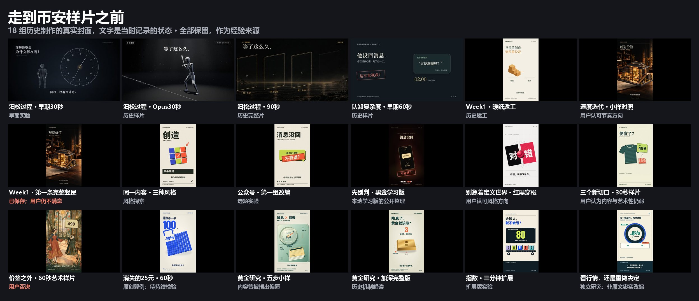</a>

失败也是资产。8 个案例都保留原片、用户反馈、观测范围和重测条件，[在线查看](https://ninglinliu.github.io/script-to-video-skill/examples/reflections/)；Agent 选路时会自动带出相关评价，不用通读聊天记录。

| 案例 | 状态 | 关键教训 |
|---|---|---|
| **R08 币安 3D 微缩** | **用户认可** | 真 3D、主体做事、交接画出来 |
| R01 像素街区 | 用户否决 | 背景加贴纸加推镜头，不等于主体动画 |
| R02 价签之外 | 用户否决 | 精美静帧加图解运动，不等于艺术动画 |
| R03 帕累托初版 | 用户否决 | 组件测试不能扩成成片；有 SRT 不等于字幕入画 |
| R04 队列片 | 用户否决 | 参数化丢了原片的美术和动作 |
| R05 Kelly 测试 | 用户否决 | 只迁移运行环境，画面还是从零写 |
| R06 基金清仓纸面版 | 用户否决 | 字幕修好了，仍像 PPT |
| R07 原版泊松 | 方向保留 | 喜欢方向，部分解释动作没实现 |

| 像素街区：背景与贴纸位移不能代替主体动画 | 《价签之外》：美术与局部运动没有形成完整交互 |
|---|---|
| [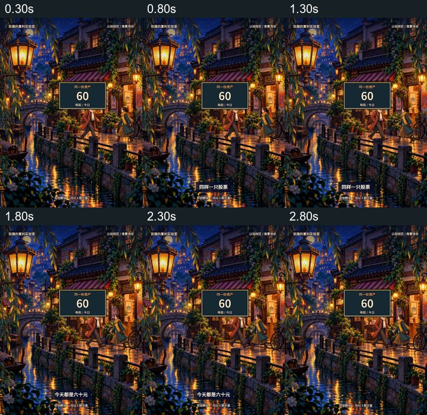](https://ninglinliu.github.io/script-to-video-skill/examples/reflections/#R01) | [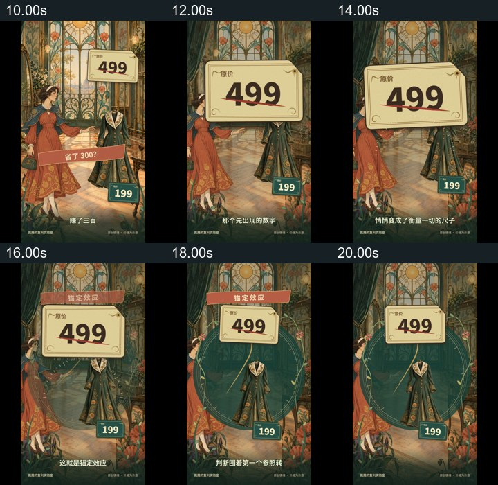](https://ninglinliu.github.io/script-to-video-skill/examples/reflections/#R02) |

```sh
python scripts/experience.py select --stage plan --route diorama-3d     # 选路时带出历史评价
python scripts/experience.py select --stage repair --query "字幕孤字"    # 按症状查经验
python scripts/experience.py reflection R08                             # 看完整案例
```

---

## 素材库与旧路线展厅

[**打开完整在线展厅：43 个专题页 →**](https://ninglinliu.github.io/script-to-video-skill/examples/gallery/) 13 个制作风格展示、35 种艺术场景、9 类解说语法、18 组历史制作。默认路线需要换风格时从这里取。

> 下面的风格图来自 [weilanx](https://github.com/Azure12355/weilanx-claude-videos) / [huashu-art-motion](https://github.com/alchaincyf/huashu-art-motion) 的公开代码预览，归原作者，MIT 及字体 OFL 随素材保留，不是本仓库的创作。每张对应的源码和配方都在库里。

| | | |
|:---:|:---:|:---:|
| [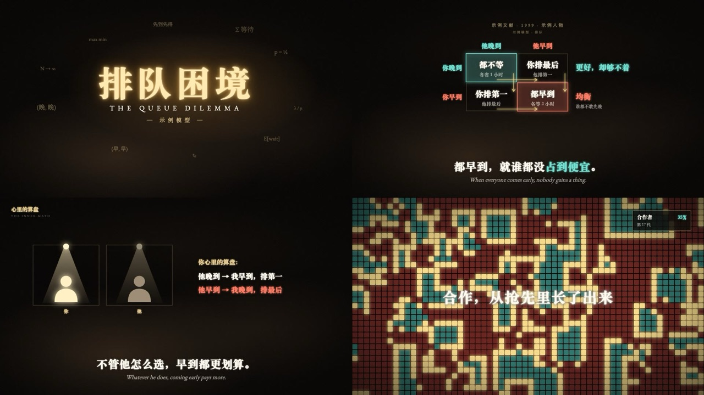](https://ninglinliu.github.io/script-to-video-skill/examples/gallery/style-blackgold.html)<br>**黑金光影** · 矩阵接分支树 | [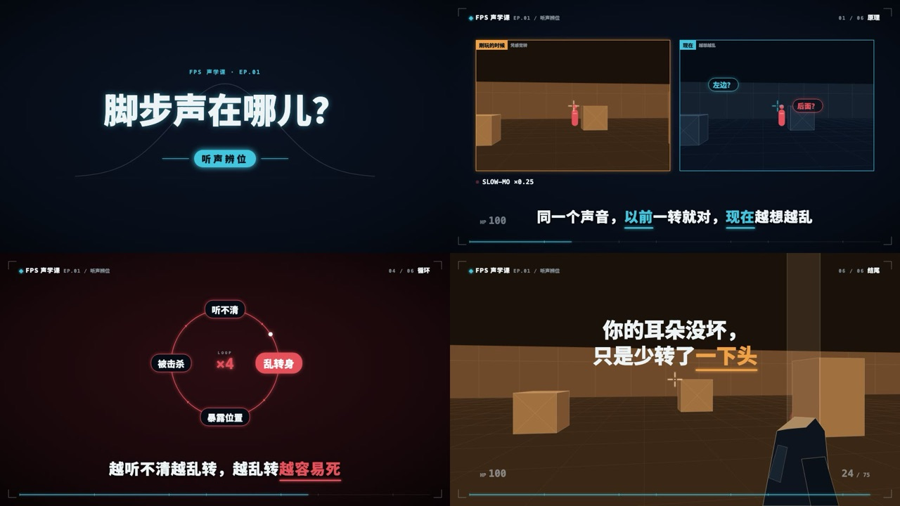](https://ninglinliu.github.io/script-to-video-skill/examples/gallery/style-tactical.html)<br>**战术屏科普** · 同空间重演 | [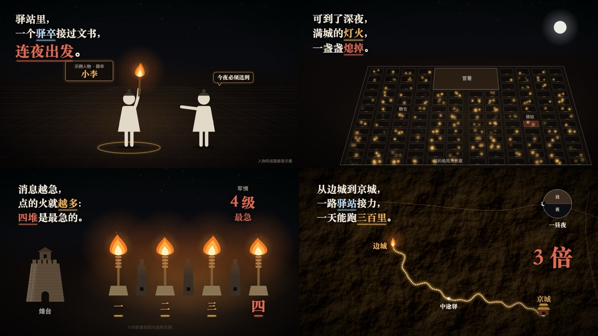](https://ninglinliu.github.io/script-to-video-skill/examples/gallery/style-lamplight.html)<br>**灯火史话** · 路径逐段点亮 |
| [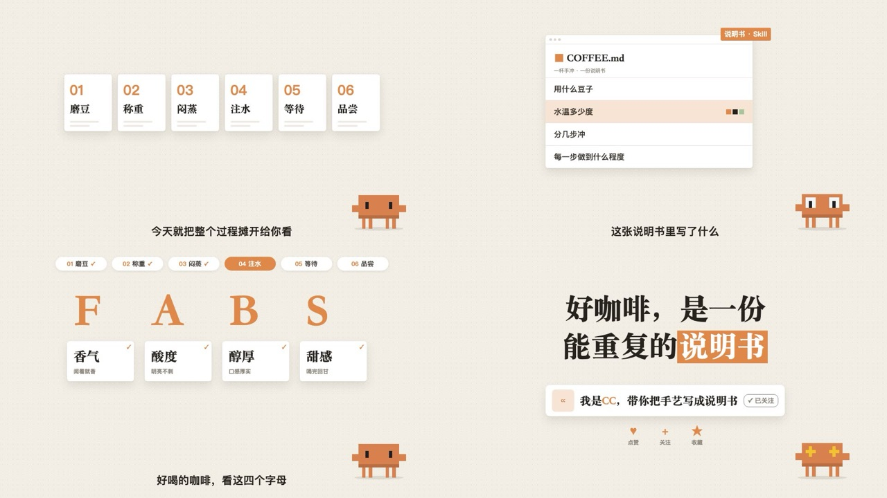](https://ninglinliu.github.io/script-to-video-skill/examples/gallery/style-warm-desk.html)<br>**暖纸工作台** · 卡片换位 | [](https://ninglinliu.github.io/script-to-video-skill/examples/gallery/style-halftone.html)<br>**网点档案** · 印章与遮挡转场 | [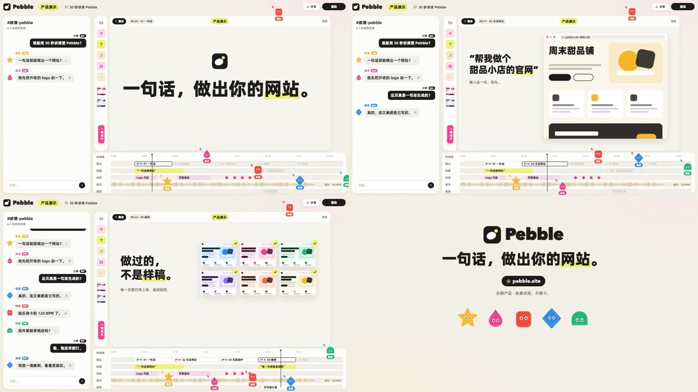](https://ninglinliu.github.io/script-to-video-skill/examples/gallery/style-editor-room.html)<br>**协作剪辑台** · 群聊触发动作 |
| [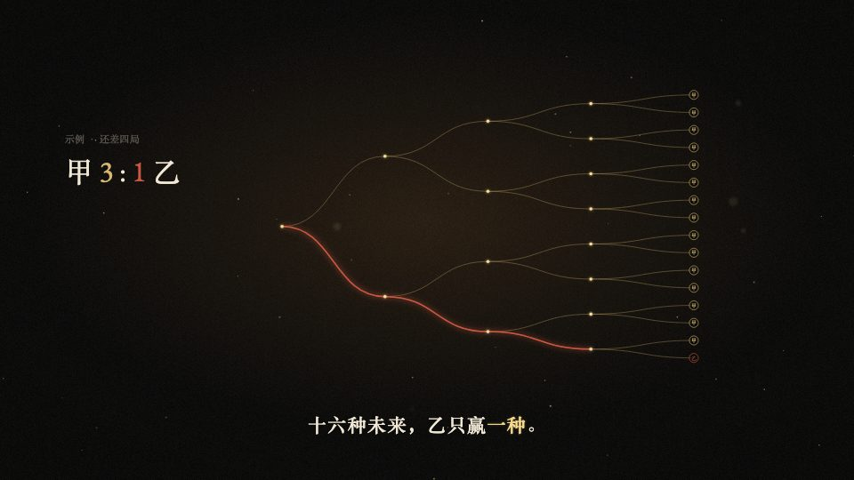](https://ninglinliu.github.io/script-to-video-skill/examples/gallery/style-gilded.html)<br>**暗金文献** · 曲线逐步绘制 | [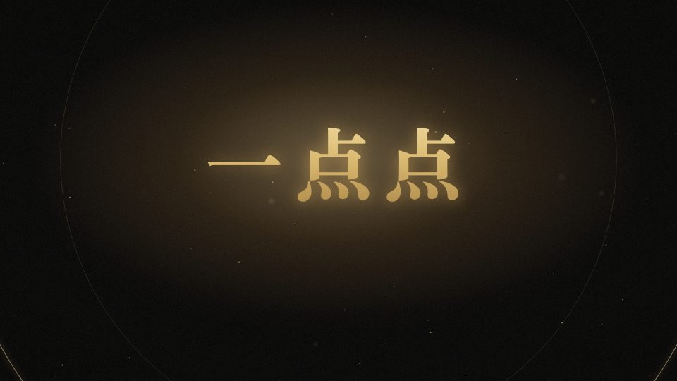](https://ninglinliu.github.io/script-to-video-skill/examples/gallery/style-gilded-ep23.html)<br>**暗金音乐短片** · 锚词落节拍 | [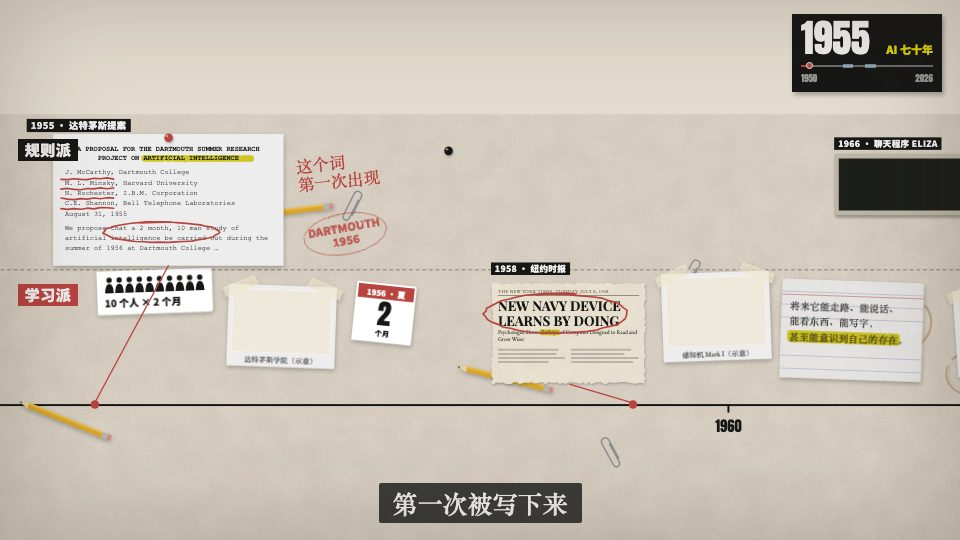](https://ninglinliu.github.io/script-to-video-skill/examples/gallery/style-vox-timeline.html)<br>**Vox 时间长卷** · 相机跟因果线 |
| [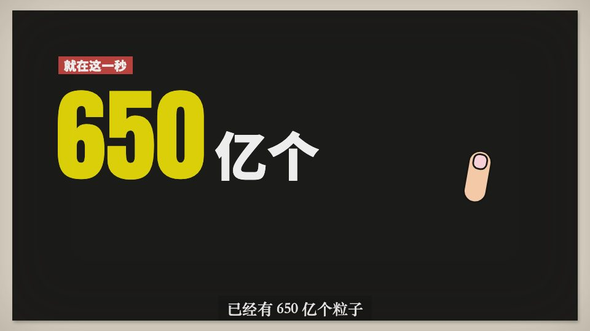](https://ninglinliu.github.io/script-to-video-skill/examples/gallery/style-vox-cut.html)<br>**Vox 硬切拼贴** · 证据画面切入 | [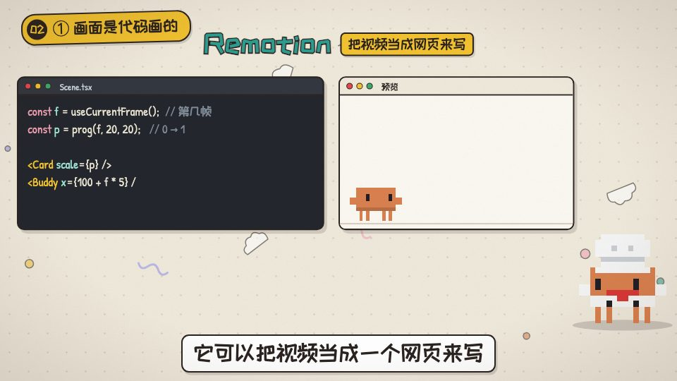](https://ninglinliu.github.io/script-to-video-skill/examples/gallery/style-pixel-handdrawn.html)<br>**像素手绘演播室** · 道具回桌面 | [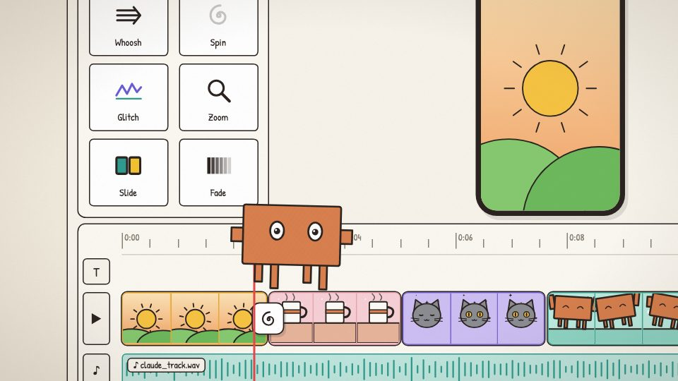](https://ninglinliu.github.io/script-to-video-skill/examples/gallery/style-vector.html)<br>**矢量手绘** · 表情配旁白 |
| [](https://ninglinliu.github.io/script-to-video-skill/examples/gallery/style-pixel-sticker.html)<br>**像素贴纸** · 注意力轮转 | | |

<details><summary><b>35 种艺术风格与 9 类解说语法</b></summary>

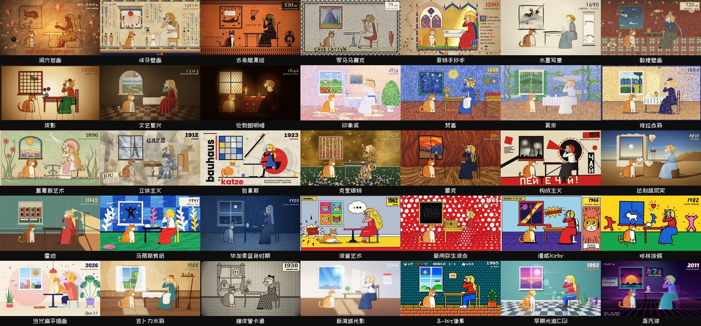

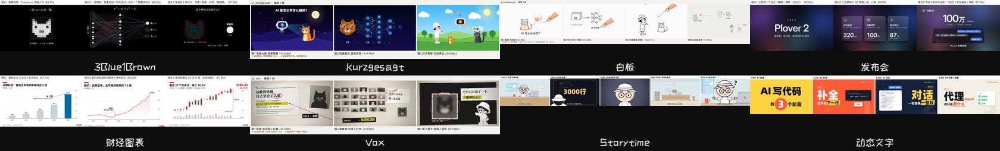

[七组艺术专题](https://ninglinliu.github.io/script-to-video-skill/examples/gallery/art-01.html) · [科普图解](https://ninglinliu.github.io/script-to-video-skill/examples/gallery/grammar-01.html) · [新闻与数据](https://ninglinliu.github.io/script-to-video-skill/examples/gallery/grammar-02.html) · [节奏与人物](https://ninglinliu.github.io/script-to-video-skill/examples/gallery/grammar-03.html) · [选材方法](references/visual-library.md)

</details>

<details><summary><b>旧路线的完整工程：106 秒章节、泊松分支、第一批组件</b></summary>

**[《回本以后，什么会改变？》](https://ninglinliu.github.io/script-to-video-skill/examples/chapter-01/)**：105.57 秒，1920×1080，7 段，含完整源码、配音、字幕和事实证据。[说明](examples/chapter-01/README.md)。后续的纸面改编被否决（R06）。


**[《泊松过程》可执行分支](references/poisson-cinema.md)**：`python scripts/start_episode.py --source poisson-cinema --episode ./episodes/new-cinema`

**[第一批组件对照](https://ninglinliu.github.io/script-to-video-skill/examples/batch-01/)**：6 条 10 秒竖屏小样。[说明](examples/batch-01/README.md)。

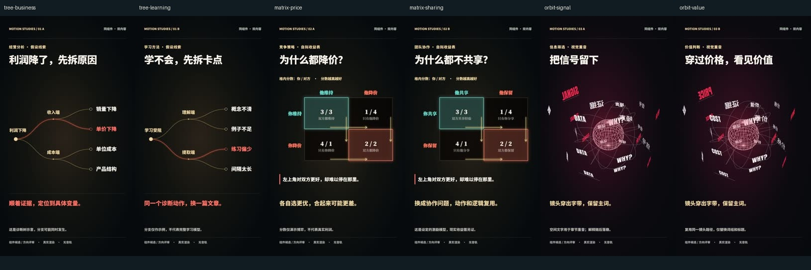

**[帕累托同文修订对照](https://ninglinliu.github.io/script-to-video-skill/examples/pareto-revision/)** · **[像素街区分支](examples/pixel-scene-map/index.html)**（用户否决，保留研究）

技术验收器：`python scripts/audit_episode.py --episode <目录> --profile task-short --output audit.json`，协议见 [episode-contract](references/episode-contract.md)。它检查规格、解码、音轨和记录，不能证明观众满意。

</details>

---

## 安装

需要一个能执行工具、能看图的 Agent。三选一，目录都命名为 `script-to-video`，已有同名 Skill 时先备份：

```sh
# ① 只要默认路线（推荐）：稀疏克隆，约 60 MB，不下载历史媒体
git clone --filter=blob:none --sparse https://github.com/ninglinLiu/script-to-video-skill.git ~/.codex/skills/script-to-video
cd ~/.codex/skills/script-to-video
git sparse-checkout set scripts references tests evals docs assets/diorama-kit examples/binance-1029 examples/pareto-diorama

# ② 打一个轻量安装包：在完整仓库里运行，再解压到 Skill 目录
python scripts/package_skill.py --out dist/script-to-video-core.zip

# ③ 完整仓库：含全部旧路线和历史影片
git clone https://github.com/ninglinLiu/script-to-video-skill.git ~/.codex/skills/script-to-video
```

运行依赖：Python 3.11+、Node 18+、ffmpeg/ffprobe、edge-tts、系统上的 Chrome 或 Edge。`python scripts/diorama.py doctor` 会逐项检查。其他兼容 Agent 按自身规则加载根目录的 `SKILL.md`。

调用示例：

> 使用 $script-to-video，把这篇文章做成 60 秒 3D 动画。先给我看一段观感测试片，通过了再渲整片。预览静音。

默认规格：60–90 秒，1920×1080/30fps，H.264 CRF14，AAC，字幕烧入并附 SRT。竖屏和其他规格见[项目配置](references/production-profiles.md)。

---

## 维护这个仓库

1. **先改设计。** 入口、目录职责或路线关系变化时，先改 [architecture.mmd](docs/architecture.mmd)、[production-flow.mmd](docs/production-flow.mmd) 和[目录职责表](docs/architecture-layout.json)。
2. **再改内容。** 实现工具、规则或素材，按实际反馈更新经验与反思。README 的图用 `scripts/build_readme_media.py` 从实际成片生成。
3. **提交前同步并检查。** 脚本从 Git 索引生成 README 的两张图、目录树和体积统计，GitHub 每次 push / PR 再查一遍。

```sh
python scripts/repo_inventory.py          # 暂存本次内容后运行，再暂存生成结果
python scripts/repo_inventory.py --check
python -m unittest discover -s tests -p "test_diorama.py"
```

**删除已有文件前先问用户。** 步骤见 [CONTRIBUTING](CONTRIBUTING.md)，给 Agent 的约定见 [AGENTS](AGENTS.md)。检查器能发现文件不一致，不能判断片子好不好看。2026-10-29 版的 README 全文保存在[这里](docs/README-20261029.md)。

## 许可

原创工作流、脚本和动画代码用 MIT。第三方组件、字体和引用材料的许可与来源见 [NOTICE](NOTICE.md)。币安样片的事实来自 [TRM Labs](https://www.trmlabs.com/resources/blog/north-korea-steals-usd-6-36-billion-from-binance-in-the-largest-hack-in-history) 和 [@0xNaiXi](https://x.com/0xNaiXi/status/2115967318274789609)，套利收益是后者的链上统计，未独立复算，内容不构成投资建议。
