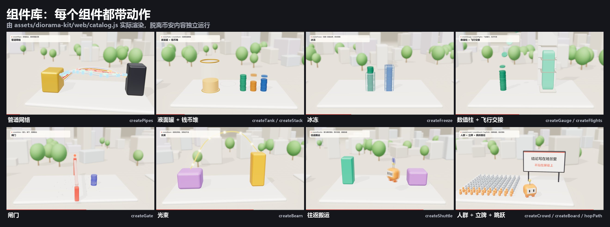

# diorama-kit

3D 微缩一镜到底的套件，从用户认可的币安样片提炼。路线说明见 [diorama-3d](../../references/diorama-3d.md)，动作参数见 [motion-craft](../../references/motion-craft.md)。



| 文件 | 作用 |
|---|---|
| `tts.py` | 读 `source/script.json`，edge-tts 逐句合成，保存真实词界，输出 `audio/timeline.json`、`audio/voice.wav` |
| `srt.py` | 由 timeline 生成 `out/subtitles.srt`，分行规则与画面字幕一致 |
| `render.mjs` | 无头 Chromium 逐帧截图，经管道交给 ffmpeg：`setup`、`stills`、`clip`、`full` |
| `web/motion.js` | 动效函数：spring、stagger、arc、squash、track、count、rng |
| `web/stage.js` | 舞台：渲染器、景深、泛光、运动模糊、灯光、地面、远景、连续镜头 |
| `web/overlay.js` | 叠加层：跟随标签、数字面板、状态条、词界字幕、进度条、片尾卡 |
| `web/props.js` | 动作组件，见下表 |
| `web/scene.js` | 起手场景，复制后改站点、动作、镜头三段 |
| `web/catalog.js` | 组件目录，每个组件一个站点：`node render.mjs clip 0 46 --q scene=catalog` |

## 组件

| 组件 | 动作 | 数据怎么进来 |
|---|---|---|
| `createFlights` | 物体从 A 抛物线飞到 B，可数已落地 | 落地数驱动计数和柱高 |
| `createStack` | 钱币一枚枚落下叠高 | 堆高 = 金额 |
| `createPipes` | 多路玻璃管，按时间窗点亮，代币流过 | 每路 value 和到达比例 |
| `createTank` | 液面升降 | 液面 = 余额比例 |
| `createFreeze` | 冰块从底部长出，碎冰四溅 | 冰块高度 = 冻结比例 |
| `createGauge` | 带背板和刻度的数值柱 | `map(value)` 决定柱高 |
| `createGate` | 蓄力、砸下、回弹、扬尘、警示灯 | 关闭和打开的时刻 |
| `createBeam` | 光束逐段长出，脉冲持续传递 | 表示信息过得去、实物过不去 |
| `createMascot` | 暖色方块角色，3/4 朝向，挤压拉伸 | `pose(t, pos, facing, sq, appear, item)` |
| `createShuttle` | 往返搬运，四次交接，逐趟加速 | 已完成趟数驱动累计量 |
| `hopPath` | 按落地时刻排一路跳跃 | keys：时刻、位置、朝向 |
| `createCrowd` | 小人方阵，错峰站起，可变色、升高 | 回调给每个人的状态 |
| `createBoard` | 结论立牌，从上方落下回弹 | 文字行 |
| `createInstances` | 通用实例组：地块、柱阵、豆荚 | `set(i, pos, scale, col)` |

规则：组件状态只依赖时间 `t`，因为运动模糊会用不同的 t 多次调用。不要在 update 里累加状态。

## 起一个新工程

```sh
python scripts/diorama.py doctor
python scripts/diorama.py new --episode ./ep        # 或 --source binance-1029 从完整案例起步
cd ep
# 写 source/script.json，然后：
python tts.py .                                     # 需要 edge-tts、ffmpeg
npm install                                         # three 0.158、playwright-core
node render.mjs setup                               # 复制 three.js 到 web/vendor
node render.mjs stills 1,4,8
node render.mjs clip 3 9 --mb 4
node render.mjs full --mb 4
python srt.py .
```

依赖：Node 18+、Python 3.11+、ffmpeg/ffprobe、edge-tts，以及系统上的 Chrome 或 Edge。已有依赖时可以用环境变量跳过安装：`THREE_DIR` 指向 `node_modules/three`，`PLAYWRIGHT` 指向 playwright 包，`CHROME` 指向浏览器。字体用系统的微软雅黑、苹方或 Noto Sans SC，缺中文字体时文字会变方块。

竖屏加 `--w 1080 --h 1920`。字幕会自动缩到放得下，但镜头关键帧要按竖屏重排，这条路还没有成片验证。
