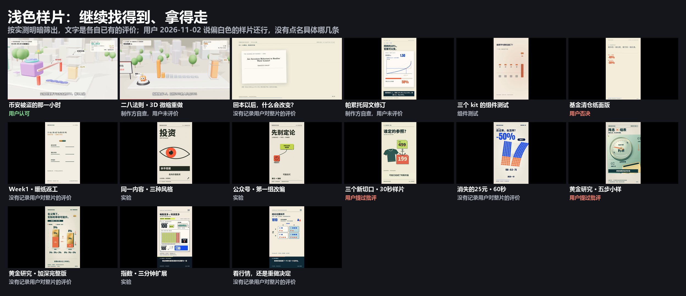
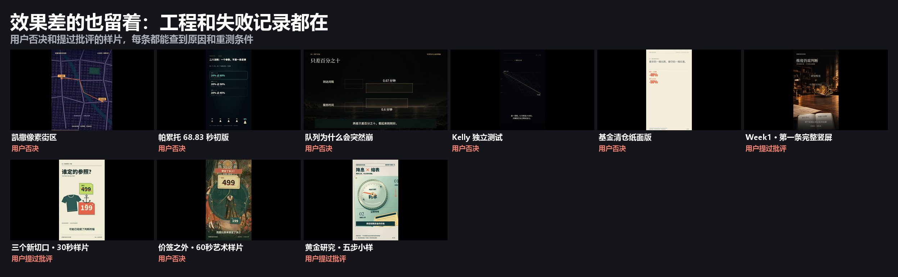

# 样片总目录

由 `python scripts/samples.py doc` 从 [sample-catalog.json](../references/sample-catalog.json) 生成，不要手改。共 31 组：制作方自查，用户未评价 3 · 用户认可（部分） 1 · 用户认可 1 · 没有记录用户对整片的评价 7 · 用户认可方向 3 · 组件测试 1 · 用户否决 6 · 实验 5 · 方向保留，局部不足 1 · 用户提过批评 3。

用户 2026-11-02 说：“之前几个偏白色风格的样片，我觉得还行，希望保留并能继续找到、取用。”用户没有点名是哪几条，所以这里不给单条片加认可；下面按实测明暗列出，各自的评价照旧。

明暗是对实际视频抽 9 帧测的 L*（中位数 ≥62 浅色，<30 深色；深帧和浅帧都占到 25% 以上算明暗交替），不代表好坏。评价只记录发生过的事；“本机”表示工程只在制作者的电脑上，没有入库。

| ID | 片名 | 明暗 | 评价 | 记录 | 看片 | 工程 | 案例 |
|---|---|---|---|---|---|---|---|
| `caesar-kelly` | 凯利公式 | 深色 | 制作方自查，用户未评价 | 按老板喜欢的《临界点》参考片风格做的第一条，制作方自查，用户和老板都还没看。 | [在线](https://ninglinliu.github.io/script-to-video-skill/examples/caesar-kelly/) | [仓库](../examples/caesar-kelly) | — |
| `caesar-ai-bubble` | AI不是泡沫，OpenAI才是 | 深色 | 用户认可（部分） | A「低频悬疑」配乐版用户认可；画面用户没有单独评价。 | [在线](https://ninglinliu.github.io/script-to-video-skill/examples/caesar-ai-bubble/) | [仓库](../examples/caesar-ai-bubble) | R09 |
| `binance-1029` | 币安被盗的那一小时 | 浅色 | 用户认可 | 用户认可的初版质量基准，约为参考效果五成。 | [在线](https://ninglinliu.github.io/script-to-video-skill/examples/binance-1029/) | [仓库](../examples/binance-1029) | R08 |
| `pareto-diorama` | 二八法则 · 3D 微缩重做 | 浅色 | 制作方自查，用户未评价 | 第二内容验证，制作方自查，弱点写在它的 README。 | [在线](https://ninglinliu.github.io/script-to-video-skill/examples/pareto-diorama/) | [仓库](../examples/pareto-diorama) | — |
| `chapter-01` | 回本以后，什么会改变？ | 浅色 | 没有记录用户对整片的评价 | 106 秒章节工程。后续同风格的改编被否决（R06），原片没有记录用户对整片的评价。 | [在线](https://ninglinliu.github.io/script-to-video-skill/examples/chapter-01/) | [仓库](../examples/chapter-01) | — |
| `pareto-revision` | 帕累托同文修订 | 浅色 | 制作方自查，用户未评价 | 补上字幕和节奏的同文修订，制作方自查；主体多数时间不动。 | [在线](https://ninglinliu.github.io/script-to-video-skill/examples/pareto-revision/) | [仓库](../examples/pareto-revision) | — |
| `batch-01` | 第一批组件小样 | 深色 | 用户认可方向 | 用户认可第一批组件方向，不等于之后的成片自动通过。 | [在线](https://ninglinliu.github.io/script-to-video-skill/examples/batch-01/) | [仓库](../examples/batch-01) | — |
| `production-gates` | 三个 kit 的组件测试 | 浅色、深色 | 组件测试 | 只验证组件能跑，不作为审美基准。 | [在线](https://ninglinliu.github.io/script-to-video-skill/examples/production-gates/) | [仓库](../examples/production-gates) | — |
| `pixel-scene-map` | 凯撒像素街区 | 中间调、深色 | 用户否决 | 用户否决：不流畅，像背景图叠字幕，人物只是贴纸上下移动。 | [在线](https://ninglinliu.github.io/script-to-video-skill/examples/pixel-scene-map/) | [仓库](../examples/pixel-scene-map) | R01 |
| `r03-pareto-first` | 帕累托 68.83 秒初版 | 深色 | 用户否决 | 用户否决：没字幕、节奏差、画风阴郁。 | [视频](../examples/failed-cases/R03-pareto-first/media/preview-silent.mp4) | [仓库](../examples/failed-cases/R03-pareto-first) | R03 |
| `r04-queue-poisson` | 队列为什么会突然崩 | 明暗交替 | 用户否决 | 用户否决：动画视觉质量不达标，内容写得更好不能弥补。 | [视频](../examples/failed-cases/R04-queue-poisson/media/preview-silent.mp4) | [仓库](../examples/failed-cases/R04-queue-poisson) | R04 |
| `r05-kelly-test` | Kelly 独立测试 | 深色 | 用户否决 | 用户否决：效果差，只复用了字体和运行环境，画面重新写。 | [视频](../examples/failed-cases/R05-kelly-test/media/preview-silent.mp4) | [仓库](../examples/failed-cases/R05-kelly-test) | R05 |
| `r06-fund-paper` | 基金清仓纸面版 | 浅色 | 用户否决 | 用户否决：字幕修好了，仍像 PPT、缺动画。 | [视频](../examples/failed-cases/R06-fund-paper/media/preview-silent.mp4) | [仓库](../examples/failed-cases/R06-fund-paper) | R06 |
| `poisson-first` | 泊松过程 · 早期30秒 | 深色 | 实验 | 早期实验。 | [在线](https://ninglinliu.github.io/script-to-video-skill/examples/gallery/film-poisson-first.html) | 本机：`Claudebao/vibe-knowledge-test/productions/poisson_30s` | — |
| `poisson-opus` | 泊松过程 · Opus30秒 | 深色 | 没有记录用户对整片的评价 | 历史样片，没有记录用户对整片的评价。 | [在线](https://ninglinliu.github.io/script-to-video-skill/examples/gallery/film-poisson-opus.html) | 本机：`Claudebao/vibe-knowledge-test/productions/opus_poisson_30s` | — |
| `poisson-full` | 泊松过程 · 90秒 | 深色 | 方向保留，局部不足 | 用户更喜欢原版的视觉方向；复盘指出部分解释动作没有实现。 | [在线](https://ninglinliu.github.io/script-to-video-skill/examples/gallery/film-poisson-full.html) | 本机：`Claudebao/vibe-knowledge-test/productions/poisson_90s` | R07 |
| `cognitive-first` | 认知复杂度 · 早期60秒 | 明暗交替 | 没有记录用户对整片的评价 | 历史样片，没有记录用户对整片的评价。 | [在线](https://ninglinliu.github.io/script-to-video-skill/examples/gallery/film-cognitive-first.html) | 本机：`Claudebao/vibe-knowledge-test/productions/cognitive_complexity_60s` | — |
| `revision` | Week1 · 暖纸返工 | 浅色 | 没有记录用户对整片的评价 | 第一周的暖纸风格返工，没有记录用户对整片的评价。 | [在线](https://ninglinliu.github.io/script-to-video-skill/examples/gallery/film-revision.html) | [仓库](../examples/light-projects/revision) | — |
| `paced` | 速度迭代 · 小样对照 | 深色 | 用户认可方向 | 用户认可节奏方向，不等于整片认可。 | [在线](https://ninglinliu.github.io/script-to-video-skill/examples/gallery/film-paced.html) | 本机：`Claudebao/video-week1/sample-paced-20261018` | — |
| `first-full` | Week1 · 第一条完整竖屏 | 深色 | 用户提过批评 | 已保存；用户仍不满意。 | [在线](https://ninglinliu.github.io/script-to-video-skill/examples/gallery/film-first-full.html) | [仓库](../examples/failed-cases/first-full) | — |
| `style-studies` | 同一内容 · 三种风格 | 浅色、中间调 | 实验 | 同一内容的三种风格探索。 | [在线](https://ninglinliu.github.io/script-to-video-skill/examples/gallery/film-style-studies.html) | [仓库](../examples/light-projects/style-studies) | — |
| `article-studies` | 公众号 · 第一组改编 | 浅色、中间调、深色 | 实验 | 公众号第一组改编的选题实验。 | [在线](https://ninglinliu.github.io/script-to-video-skill/examples/gallery/film-article-studies.html) | [仓库](../examples/light-projects/article-studies) | — |
| `blackgold-study` | 先别判 · 黑金学习版 | 深色 | 实验 | 本地学习版的公开整理。 | [在线](https://ninglinliu.github.io/script-to-video-skill/examples/gallery/film-blackgold-study.html) | 本机：`Claudebao/video-week1/weilanx-study-20261020` | — |
| `redshift` | 别急着定义世界 · 红黑穿梭 | 明暗交替 | 用户认可方向 | 用户认可风格方向，不等于整片认可。 | [在线](https://ninglinliu.github.io/script-to-video-skill/examples/gallery/film-redshift.html) | 本机：`Claudebao/video-week1/rtiaho-study-20261021` | — |
| `content-lab` | 三个新切口 · 30秒样片 | 浅色、中间调、深色 | 用户提过批评 | 用户认为内容与艺术性仍弱。 | [在线](https://ninglinliu.github.io/script-to-video-skill/examples/gallery/film-content-lab.html) | [仓库](../examples/light-projects/content-lab) | — |
| `anchor-art` | 价签之外 · 60秒艺术样片 | 中间调 | 用户否决 | 用户否决：商店表现价签与衣物比较，人物与衣物交互不足。 | [在线](https://ninglinliu.github.io/script-to-video-skill/examples/gallery/film-anchor-art.html) | [仓库](../examples/failed-cases/R02-anchor-art) | R02 |
| `disappearing25` | 消失的25元 · 60秒 | 浅色 | 没有记录用户对整片的评价 | 原创算例，待持续检验；没有记录用户对整片的评价。 | [在线](https://ninglinliu.github.io/script-to-video-skill/examples/gallery/film-disappearing25.html) | [仓库](../examples/light-projects/disappearing25) | — |
| `gold-proof` | 黄金研究 · 五步小样 | 浅色 | 用户提过批评 | 内容曾被指出偏薄。 | [在线](https://ninglinliu.github.io/script-to-video-skill/examples/gallery/film-gold-proof.html) | [仓库](../examples/light-projects/gold-proof) | — |
| `gold-full` | 黄金研究 · 加深完整版 | 浅色 | 没有记录用户对整片的评价 | 历史机制解读，没有记录用户对整片的评价。 | [在线](https://ninglinliu.github.io/script-to-video-skill/examples/gallery/film-gold-full.html) | [仓库](../examples/light-projects/gold-full) | — |
| `index-machine` | 指数 · 三分钟扩展 | 浅色 | 实验 | 三分钟扩展版实验。 | [在线](https://ninglinliu.github.io/script-to-video-skill/examples/gallery/film-index-machine.html) | [仓库](../examples/light-projects/index-machine) | — |
| `decision-frequency` | 看行情，还是重做决定 | 浅色 | 没有记录用户对整片的评价 | 独立研究，非原文忠实改编；没有记录用户对整片的评价。 | [在线](https://ninglinliu.github.io/script-to-video-skill/examples/gallery/film-decision-frequency.html) | [仓库](../examples/light-projects/decision-frequency) | — |
