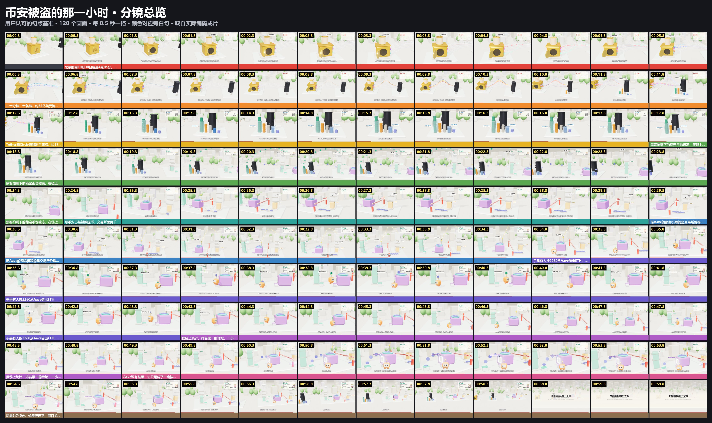

# 币安 10.29 · 被盗的那一小时

**用户认可的初版制作案例和质量基准。** 用户 2026-11-01 看过后说："我很满意，符合初版要求。虽然还没达到那两条参考动画的效果，但做到参考效果的五成左右，我就已经比较满意了。"认可范围是这一条 60 秒横屏，不自动推广到别的画幅或题材（R08）。

[▶ 在线播放](https://ninglinliu.github.io/script-to-video-skill/examples/binance-1029/) · [1080p 成片](media/final-1080p.mp4) · [SRT](media/subtitles.srt) · [路线说明](../../references/diorama-3d.md)



60 秒，1920×1080/30fps，一镜到底。讲的是币安热钱包被盗期间，链上与交易所之间出现的约一小时价差窗口，以及 Aave 预言机如何被用来套利。

| 文件 | 内容 |
|---|---|
| `media/final-1080p.mp4` | 用户认可的成片原文件，H.264 CRF14，24.8MB |
| `media/preview.mp4` | 720p 网页预览 |
| `media/subtitles.srt` | 由真实词界生成的字幕，分行与画面一致 |
| `source/script.json` | 10 句旁白、字幕分行、每句来源 |
| `source/sources.md` | 来源与口径；第三方链上统计未独立复算 |
| `audio/timeline.json` | edge-tts 7.3.1 逐句合成的真实 WordBoundary（zh-CN-YunxiNeural，+18%） |
| `web/scene.js` | 被认可版本的场景源码，**保持原样不改**；新片用 `assets/diorama-kit` 的组件 |
| `qa/` | 观感测试静帧、动作连续帧、整片 2fps 接触表 |

## 复现

```sh
python scripts/diorama.py new --episode ./ep --source binance-1029
cd ep && npm install && node render.mjs setup
node render.mjs stills 2,15,25.5,38
# 整片要先 python tts.py . 生成 voice.wav；timeline 会随之更新，画面按 cue 自动对齐
```

2026-11-01 用仓库文件在空目录重建 10 个时间点，和认可成片的 SSIM 为 0.973–0.996，较低的值在快动作段。

## 站点与动作

| 旁白 | 站点 | 主体动作 → 结果 |
|---|---|---|
| L1–L2 凌晨 4:05、二十分钟十条链 | 金库 | 门弹开；10 条链管道依次点亮，币流出；余额液面下降；"已流出"由已到达的币累加到 $6.36B |
| L3 冻结约 27 亿 | 攻击者资产堆 | 币落下叠成 5 堆；冰块从底部长出包住 USDT 堆的 71% 和 USDC 堆，碎冰四溅 |
| L4 链上狂换 ETH | DEX 价格柱 | 26 枚 USDT 抛物线飞进漏斗，10 枚 ETH 飞回；绿柱从 2,300 升到约 2,650 |
| L5 暂停提币 | 闸门 | 闸杆先蓄力再砸下、回弹扬尘；交易所 8 枚 ETH 滑过来被挡住 |
| L6 预言机跟交易所价 | 光束 | 金色光束从交易所柱顶跨过闸门接到 Aave 天线，脉冲持续传递 2,280 |
| L7–L8 借、卖、还，347 万 | 搬砖小人 | 11 趟往返逐渐加速，每趟画出四次交接；绿柱随卖压下压；累计收益增长 |
| L9 按旧价出货的窗口 | Aave 侧窗 | 窗框发光，ETH 从窗口连续流向 DEX |
| L10 5:40 抹平 | 全景 | 绿柱回落到 2,290 附近，卷帘落下，闸门抬起，镜头拉远到全貌 |

## 还没做到的

制作方的观察，用户没有逐项确认：

- **质感**：干净的玩具模型感，没有参考片的全局光照、材质细节和昼夜光变化。灯光偏亮，颜色偏淡。
- **0–5 秒开场**：只有金库门打开和镜头推近，第一条链的流量很小，钩子比参考片弱。
- **15–18 秒**：冰块长好后约 3 秒主要是镜头微移和数字滚动，主体没有新动作。
- **43–49 秒**：小人在画面中占比偏小，数字面板承担了太多信息。

技术：H.264 1920×1080/30fps，AAC 48kHz，完整解码无错误，主体区没有 2 秒以上的近静止。码率 3.3 Mbps（CRF14，画面平整所致）。混音时的 `-shortest` 切掉了最后 3 帧，画面比音频短约 0.1 秒，落在片尾卡上；这个参数已从工具里去掉，这条认可过的成片不重新生成。见 `qa/delivery.json`。

## 制作记录

- three.js r158 加 Chromium（Playwright 驱动），WebGL 走 RTX 4060 Laptop。1802 帧、4 子帧运动模糊，约 0.34 秒/帧。
- 观感测试改了五轮：泛光把浅色画面冲白；价格柱读不出；小人太小太白、只见侧脸；借币动作没画出来；链名标签重叠。见[五轮对照](../../docs/media/look-test-rounds.jpg)。
- 事实来源：TRM Labs 和 @0xNaiXi 帖子，都读过全文。CoinDesk、TechCrunch、NBC、Axios、The Block 只看过搜索摘要，用来确认事件存在和暂停提币，没有逐篇细读。
