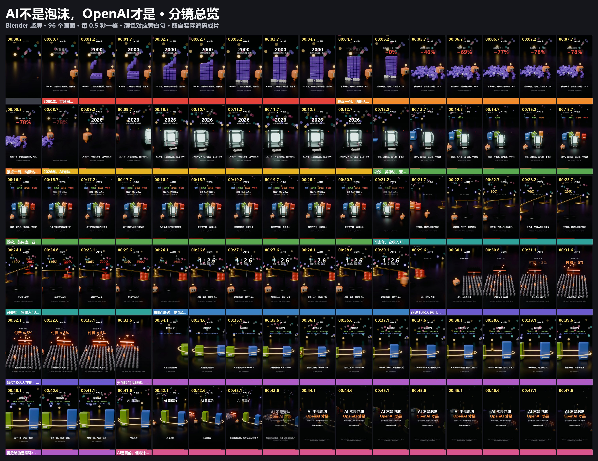
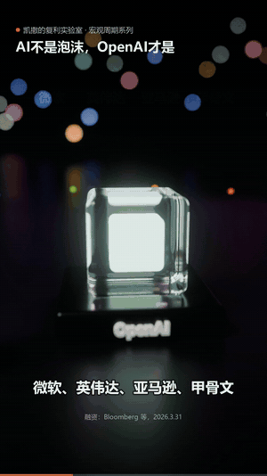
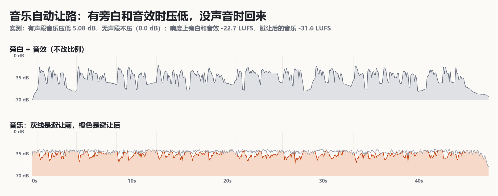

# 凯撒 · AI不是泡沫，OpenAI才是

**配乐获用户认可；画面用户没有单独评价。** 用户 2026-11-02 说：“这次凯撒样片的 A「低频悬疑」配乐版我觉得 OK”，“认可范围是这次配乐效果”（R09）。所以这里可以当配乐配方用，不能当 Blender 画面的质量基准。画面的基准仍是[币安样片](../binance-1029/README.md)。

[▶ 在线播放（有声，点了才响）](https://ninglinliu.github.io/script-to-video-skill/examples/caesar-ai-bubble/) · [1080×1920 成片](media/final-tension-1080x1920.mp4) · [SRT](media/subtitles.srt) · [配乐做法](../../references/audio-and-materials.md#用户认可的配乐做法2026-11-02)



47.81 秒，1080×1920/30fps，一镜到底，Blender Cycles 渲染。观点和结构改编自用户提供的公众号文章，数字按一手报道核对过，有两处没有照搬原文，见 [source/sources.md](source/sources.md)。文章全文不入库。

| 方块塔搭起来，再崩塌 | 四家公司接上 OpenAI |
|:---:|:---:|
|  |  |
| **天平：一枚币 10 亿美元** | **英伟达和 CoreWeave 的循环** |
|  |  |

## 配乐：被认可的部分

**发布时必须带这段署名（放简介或片尾）。这版成片画面里没有烧署名。**

```text
"Crypto" Kevin MacLeod (incompetech.com)
Licensed under Creative Commons: By Attribution 4.0
https://creativecommons.org/licenses/by/4.0/
Music trimmed, loudness-normalized, faded and ducked beneath narration and sound effects.
```

用同样的输入可以重跑出这一版：

```sh
python scripts/music_library.py fetch crypto-kevin-macleod --out audio/music
python scripts/mix_music.py --video out/final.mp4 --voice audio/mix.wav --music audio/music/Crypto.mp3 \
  --track crypto-kevin-macleod --output out/final-music.mp4 --report out/mix.json --credit-out out/music-credit.txt
```

| 项 | A 低频悬疑（用户选的） | B 电子节奏（试听过，没选） |
|---|---|---|
| 曲目 | Crypto，80 BPM，204 秒 | Cipher，150 BPM，231 秒 |
| 音乐目标响度 | −29 LUFS | −30 LUFS |
| 淡入 / 淡出 | 0.25 / 1.2 秒 | 0.25 / 1.2 秒 |
| 避让 | threshold 0.035，ratio 8，15 ms / 350 ms | 同 A |
| 总轨实测 | −16.63 LUFS，真峰值 −1.44 dBTP | [mix-electronic.json](qa/mix-electronic.json) |
| 用户状态 | 认可 | 没有否决，这条片没选 |



重跑的结果：视频流完全一致，音频只在最后约 1.4 秒有 −83.6 dBFS 量级的差异，原因是 ffmpeg 收尾调度，不是参数变化，详见[配乐做法](../../references/audio-and-materials.md#怎么验证验证到哪一步)。Agent 没有听过声音，“合不合适”只来自用户试听。

B 版成片没有入库，只留混音报告。需要时用 `--track cipher-kevin-macleod` 重混。

## 文件

| 文件 | 内容 |
|---|---|
| `media/final-tension-1080x1920.mp4` | 用户认可配乐的成片原文件，H.264，25.7 MB |
| `media/preview.mp4` | 720 宽网页预览，有声 |
| `media/poster.jpg`、`media/subtitles.srt` | 封面、字幕 |
| `media/music-credits.txt`、`media/music-credit-short.txt` | A/B 两版当时的完整记录、发布用署名 |
| `source/script.json`、`source/sources.md` | 旁白、字幕分行、来源和口径 |
| `audio/timeline.json`、`audio/events.json` | 真实词界、音效事件表。合成音效用 [`assets/diorama-kit/sfx.py`](../../assets/diorama-kit/sfx.py) |
| `blender/caesar.py`、`blender/dio_blender.py` | 场景和 Blender 工具函数 |
| `overlay.py` | 把标题、数字和字幕叠到渲染帧上 |
| `qa/mix-tension.json`、`qa/mix-electronic.json` | 当时 A、B 两版的混音报告 |
| `qa/mix-tension-repro.json`、`qa/music-levels.json` | 用补充参数后的工具重跑的报告和逐 0.1 秒电平 |

旁白 WAV、Blender 逐帧 PNG 和音乐 MP3 没有入库：前两者可以重新生成，音乐按上面的命令取。

## Blender 这条路的实际成本

用户没有评价画面，下面是制作方的记录，不是认可。RTX 4060 笔记本，Cycles OptiX，`use_persistent_data` 打开，1434 帧跑了 13805 秒，约 **9.6 秒/帧、3.8 小时**，再加约 10 分钟叠字幕。three.js 路线约 0.35 秒/帧，差 27 倍。

| 踩过的坑 | 处理 |
|---|---|
| 灯在画面里露形 | 灯光 `visible_camera=False`；轮廓光 `visible_glossy=False`，免得反射出一块亮片 |
| 把物体传送到远处藏起来，运动模糊拉出一道光 | 在出生点把缩放设成 0，不要传送 |
| 共用网格连带共用材质，红币变成了金色 | 改色的物体单独复制材质 |
| 动作对不上词 | `word_t` 要匹配分词结果，比如“花掉”可能被拆成两个词 |
| 进程中途被杀 | 按缺失帧续渲，不要从头开始 |

## 制作方自查的弱点

用户没有逐项确认。这些不影响配乐认可，但也说明画面不能算过关。

- **画面很暗。** 整片 L\* 约 20。用户此前否决过阴郁画风（R03），又说偏白色的样片还行，所以深色不要当成默认方向。
- 从 16 秒到 21 秒，电缆场景的主体动作基本停了，靠数字推进。
- 34 到 41 秒的循环段约 7 秒，构图变化很小。
- 片尾 44 秒之后基本是静止文字，没有主体动作。
- 来源小字偏小，竖屏手机上读起来吃力。
