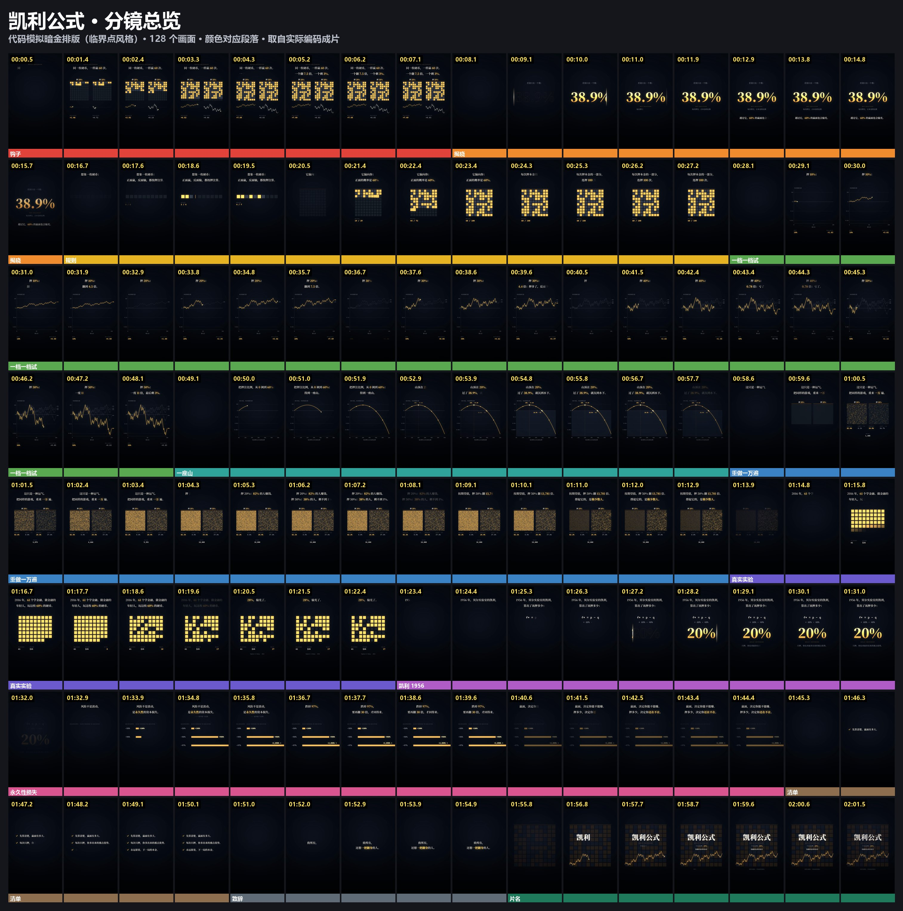
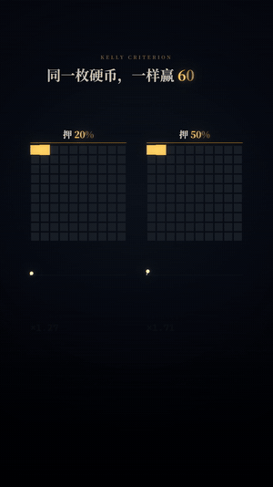
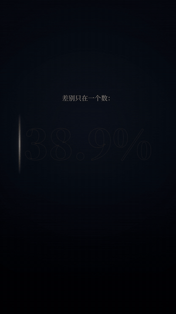
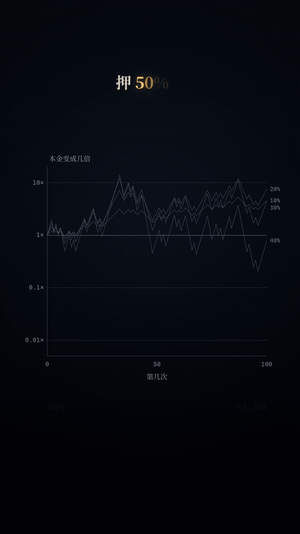
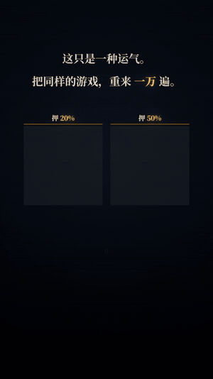

# 凯撒 · 凯利公式（临界点风格）

**制作方自查，用户和老板都还没看。** 用户 2026-11-09 说老板（凯撒）喜欢参考片《临界点：渗流理论》，要按这个标准用凯撒公众号的内容做一条样片。这是按[代码模拟暗金排版](../../references/sim-typography.md)做的第一条。它和 [3D 微缩](../binance-1029/README.md)是并列的两种风格，开工前先问用户选哪种。

[▶ 在线播放（有声，点了才响）](https://ninglinliu.github.io/script-to-video-skill/examples/caesar-kelly/) · [1080×1920 成片](media/final-1080x1920.mp4) · [来源与口径](source/sources.md) · [路线说明](../../references/sim-typography.md)



122 秒，1080×1920/30fps，只有音乐。讲的是：同一枚正面概率 60% 的硬币，一样赢 60 次输 40 次，每次押 20% 的人翻到 7.5 倍，押 50% 的人只剩 3%。差别只在一个数：在正面概率 60%、等额盈亏的这组假设下，押注比例超过约 38.9% 时，长期典型财富会趋向零。最后落到凯撒文章里那句“风险不是波动，是永久性的资本损失”。

| 同样的运气，押 20% 和押 50% | 光条扫亮那个数 |
|:---:|:---:|
|  |  |
| **押 50%：一度 11 倍，最后剩 3%** | **重来一万遍** |
|  |  |

## 照参考片学了什么

| 参考片的做法 | 这条片怎么用 |
|---|---|
| 58% 和 0% 并排，看起来一样 | 两个人同样赢 60 次输 40 次，并排两张格子完全一样，下面的曲线一个涨一个崩 |
| 光条扫亮 59.27% | 光条扫亮 38.9% 和 20% |
| 30% → 50% → 58% → 60%，一档一档试 | 押 10% → 50%，旧结果留成灰线 |
| 重做一万遍，曲线变成一堵墙 | 一万个人各抛 100 次，两张 100×100 的格子 |
| 1957 年 Broadbent 和 Hammersley | 1956 年凯利；2016 年 61 人的真实实验 |
| 清单、“致所有，还在 58% 的人”、片名卡 | 三条清单、“致所有，还想一把翻身的人”、凯利公式片名卡 |

参考片的原片、截图和音乐都只在用户本机，不进仓库。

## 画面实现与起步命令

| 参考片的手法 | 这条片怎么做 | 工具 |
|---|---|---|
| 数是真算出来的 | `data/build_data.py` 算出所有上屏数字：38.9%、82%、13,781 倍……画面和文字读同一个文件 | `simfilm.py new` |
| 逐字打出，光条扫亮大数字 | 粗宋体两行标题，金色只给关键词；38.9% 和 20% 用光条扫亮 | `head()`、`bigNumber()` |
| 一档一档试，再重做一万遍 | 押 10% → 50%，旧结果留成灰线；一万个人各抛 100 次，两张 100×100 的格子 | `line()`、`cells()` |
| 有出处的真实锚点 | 1956 年凯利；2016 年 61 人的硬币实验，28% 输光 | 片中小字注明 |
| 只有音乐 | A：Stay the Course；B：上次认可的 Crypto；−14 LUFS，用户还没听 | `mix_music.py` 不传 `--voice` |

```sh
python scripts/simfilm.py new --episode ./ep --source caesar-kelly    # 从这条样片起步；不加 --source 是 21 秒的起手场景
cd ep && python data/build_data.py && node render.mjs full
```

## 数据：画面上的数都从一个文件来

```sh
python data/build_data.py      # → web/data.json、qa/data-summary.json；需要 numpy、scipy
```

正反顺序、一万遍模拟都固定了随机种子，重跑结果一样。每个数怎么来的见[来源与口径](source/sources.md)。凯利公式和算例是制作方原创，不是文章里的内容；真实实验引自 Haghani & Dewey (2016)。

## 配乐

做了两版，用户还没听：

| 版本 | 曲目 | 说明 |
|---|---|---|
| A（成片用的） | [Stay the Course](https://incompetech.com/music/royalty-free/index.html?isrc=USUAN1900018)，Kevin MacLeod，60 BPM，暗、稳 | [混音报告](qa/mix-a.json) |
| B | [Crypto](https://incompetech.com/music/royalty-free/index.html?isrc=USUAN1600013)，Kevin MacLeod，80 BPM，上次凯撒样片用户认可的那首 | [混音报告](qa/mix-b.json)，成片只在本机 |

纯音乐，用 `mix_music.py` 不传 `--voice`：总轨 −14 LUFS，真峰值 −1.5 dBTP，淡入 0.5 秒，淡出 3 秒，画面码流原样复制。**发布时必须带署名，放简介或片尾：**

```text
"Stay the Course" Kevin MacLeod (incompetech.com)
Licensed under Creative Commons: By Attribution 4.0
https://creativecommons.org/licenses/by/4.0/
Music trimmed, loudness-normalized and faded.
```

## 重做这一条

```sh
python scripts/simfilm.py new --episode ./ep --source caesar-kelly
cd ep
python data/build_data.py
node render.mjs stills 3.9,10.5,47.6,55.5 --dir s1
node render.mjs full                              # RTX 4060 笔记本约 0.28 秒/帧，整片约 17 分钟
python ../scripts/music_library.py fetch stay-the-course-kevin-macleod --out audio/music
python ../scripts/mix_music.py --video out/video-silent.mp4 --music "audio/music/Stay the Course.mp3" \
  --track stay-the-course-kevin-macleod --output out/final.mp4 --report out/mix.json --credit-out out/music-credit.txt
```

## 文件

| 文件 | 内容 |
|---|---|
| `media/final-1080x1920.mp4` | A 版成片 |
| `media/preview.mp4`、`media/poster.jpg` | 720 宽网页预览、封面 |
| `media/music-credit.txt` | 发布用署名 |
| `web/scene.js` | 12 段场景；画面原语在 [sim-kit](../../assets/sim-kit/README.md) |
| `web/data.json`、`data/build_data.py` | 片中所有数字和算它们的脚本 |
| `qa/data-summary.json` | 数字摘要，供核对 |
| `qa/cards.json` | 分段表，分镜总览按段分色 |
| `qa/mix-a.json`、`qa/mix-b.json` | 两版混音报告 |
| `qa/review-*.jpg` | 观感测试时的静帧拼图 |

## 制作方自查的弱点

用户和老板都没看过，下面是制作方自己看出来的：

- 参考片的格子是真的渗流在蔓延，前沿一格格烧过去，很抓眼；这条片的硬币格子只是翻开，动感弱一些。
- 第 ⑨ 段的回本条形图比参考片更像信息图，少了模拟感。
- 全片 122 秒，比参考片短，“为什么是 38.9%”只给了结果，没有像参考片那样演“只能一位一位算出来”。
- 画面暗。这是参考片的风格，但用户以前否决过阴郁的画风（R03），也说过偏白色的样片还行；要不要出一版浅色，等用户和老板看过再定。
