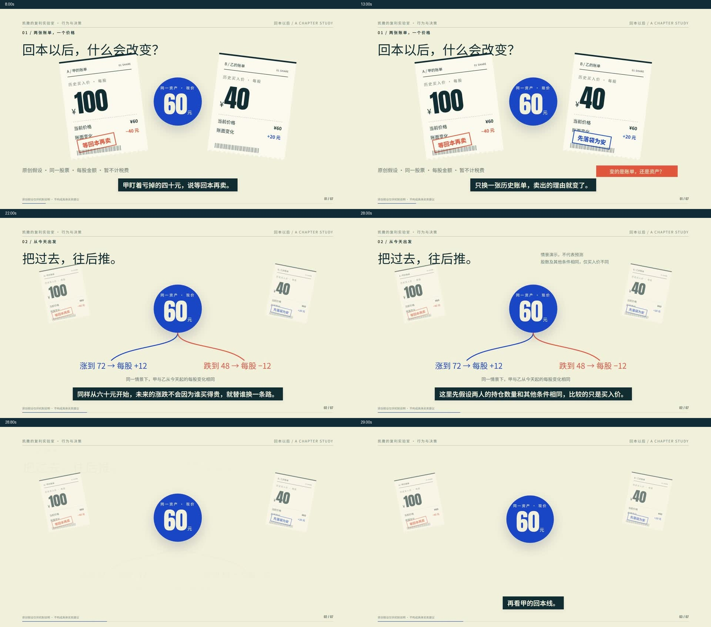

# 完整章节：回本以后，什么会改变？

**105.57秒 / 1920×1080 / 30fps / 7段。** 从两张买入账单出发，沿同一现价解释未来路径、回本基数、实证依据与现实边界。此例验证章节生产，不证明8–10分钟长片已成熟。

[打开静音预览](https://ninglinliu.github.io/script-to-video-skill/examples/chapter-01/) · [配音MP4](out/final-with-audio.mp4) · [静音MP4](out/final-silent.mp4) · [字幕](out/subtitles.srt) · [口播稿](source/draft.txt)



## 包含什么

- 完整Remotion/React场景、真实配音时间戳、534汉字口播稿、SRT。
- 七段无字幕画面、无字幕全片、独立旁白WAV与原始合成MP3。
- Noto Sans SC、Noto Serif SC、Anton及OFL许可；论文题头有限节选并单独归属。
- [五步记录](plans/five-steps.json)、[跨镜状态](plans/chapter.json)、[事实审查](evidence/script-review.json)、[画面审查](qa/final-visual-review.json)。
- 配乐混音工具与外部来源记录。原参考配乐不打包；公开有声版仅旁白。

## 复用已有成片与工程

直接使用`out/`、`native/segments/`和`assets/voice-track.wav`即可，无需重新请求TTS。分段画面是渲染后的素材，内部对象动画仍在Remotion源码中编辑。

```sh
python export_timeline.py
```

生成当前机器媒体路径的`native/timeline.xml`，字幕另导入`out/subtitles.srt`。XML是FCP7交换时间线，不冒充剪映原生草稿或PR的prproj。用户已手动验证既有剪映／PR工作流并明确无需复验；本次记录不声称Agent打开了每个新工程文件。

## 渲染

需要Node.js22+、npm、Python3.11+、FFmpeg/ffprobe。

```sh
cd 工程
npm ci
npm run check
node render.mjs proof
node render.mjs final
node render.mjs clean
node render.mjs segment recovery
```

渲染器使用Remotion管理的Chrome Headless Shell，或环境变量`REMOTION_BROWSER`指定本机兼容浏览器。片段按全局帧区间渲染，保留跨镜状态。所有渲染静音。

### Windows临时目录拒绝写入

用户在另一环境实测：Remotion调用的FFmpeg写入`%TEMP%`下的`pre-encode.mp4`时报`Permission denied`，将`TEMP/TMP`改为工程自己的`.tmp`后通过。本仓库记录这一已报告的处理方法，本次未在该环境复现。

遇到同类错误时，在 **`工程`目录** 的PowerShell里、启动Remotion之前执行：

```powershell
$renderTemp = Join-Path (Get-Location).Path '.tmp'
New-Item -ItemType Directory -Path $renderTemp -Force | Out-Null
$env:TEMP = $renderTemp
$env:TMP = $renderTemp
node render.mjs proof
```

这些环境变量只作用于当前终端及其后启动的子进程；已经运行的渲染进程需重新启动。确认报错指向临时编码文件，并确保工程目录可写；若新目录仍拒写，继续检查具体路径和错误，不将所有权限问题归为同一原因。`.tmp`仅为缓存，不纳入Git或交付素材。

更换稿件须重新完成事实审查并绑定`source/draft.txt`哈希，再执行`pip install -r requirements.txt`和`python voice.py`；缓存键包含文字、音色、语速与服务版本。会发起TTS请求；现成素材不会自动重合成。源稿与JSON不一致时停止。字幕时间来自真实WordBoundary，不用等长字符分配。

重渲静音片后可重新封装现有配音：

```sh
ffmpeg -i out/final-silent.mp4 -i assets/voice-track.wav -map 0:v:0 -map 1:a:0 -c:v copy -c:a aac -b:a 192k -shortest -movflags +faststart out/final-with-audio.mp4
python ../../scripts/audit_episode.py --episode . --profile chapter-proof --output qa/audit.json
```

修改画面/稿件后旧审查不能自动沿用，应按变化范围更新真实审查记录及哈希；验收器可能因此报告incomplete，这是正常保护。

## 可复用动作与边界

| 动作 | 真实实现 | 延伸用途 |
|---|---|---|
| 同一对象退后、回来 | Receipt的跨段状态数组 | 历史信息与当前判断分层 |
| 同一数值进入另一坐标 | Price跨段插值 | 价格、概率或成本换观察范围 |
| 箭头与分母同步出现 | Recovery / cue时间 | 基数、增长率、收益比较 |
| 同一账单翻面接新证据 | Decision / Receipt | 更新假设、撤销旧理由 |
| 假设切入真实研究 | Evidence | 明确模型与证据的边界 |

这些是可读、可改的具体代码，尚未做成跨任意主题的自动组件调度器。不能只替换文案就沿用本片结论、比例与证据。

## 已检查与尚未证明

13秒连续样片→完整粗剪→4项局部修复→1080p编码。32个时间点抽样，颜色兼容转换后另复看3帧；未完整人工听音。修复记录没有替代用户审美验收，清单段的具体性、长时间素材变化与多文章稳定性仍待检验。

素材与分发范围详见[provenance.json](provenance.json)。不包含完整公众号原文、完整论文、参考原片、第三方参考配乐或账户配置。
