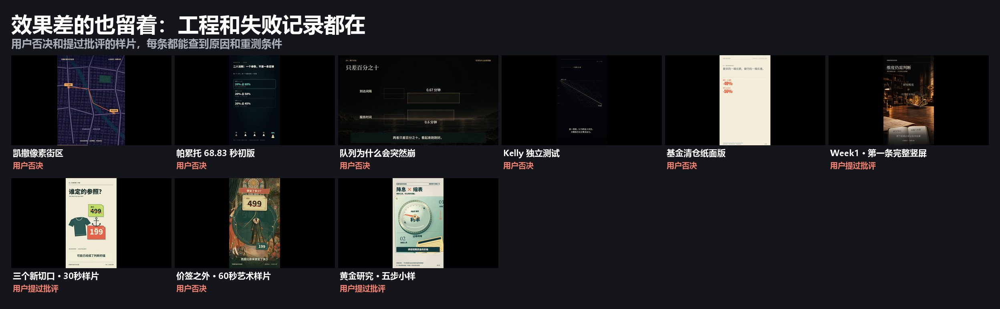

# 用户否决的工程

**这里都是用户否决过的片子，不是模板。** 留着是为了以后能打开看：当时写了什么、为什么没过、哪些东西还能用。检查记录里的“通过”只说明当时的技术状态，不改变用户的否决。



| 案例 | 片子 | 用户反馈 | 失败原因 | 看 |
|---|---|---|---|---|
| R03 | 帕累托 68.83 秒初版 | 没字幕、节奏差、画风阴郁 | 组件测试被扩成成片；有 SRT 不等于字幕入画 | [说明](R03-pareto-first/README.md) · [静音预览](R03-pareto-first/media/preview-silent.mp4) |
| R04 | 队列为什么会突然崩 | 动画视觉质量不达标，内容写得更好不能弥补 | 参数化丢了原片的美术和动作 | [说明](R04-queue-poisson/README.md) · [静音预览](R04-queue-poisson/media/preview-silent.mp4) |
| R05 | Kelly 独立测试 | 效果差，只复用了字体和运行环境 | 只迁移环境，画面从零写 | [说明](R05-kelly-test/README.md) · [静音预览](R05-kelly-test/media/preview-silent.mp4) |
| R06 | 基金清仓纸面版 | 字幕修好了，仍像 PPT、缺动画 | 工程迁移不等于动画迁移 | [说明](R06-fund-paper/README.md) · [静音预览](R06-fund-paper/media/preview-silent.mp4) |
| R02 | 价签之外 | 商店表现价签与衣物比较，人物与衣物交互不足 | 精美静帧加图解运动，不等于艺术动画 | [说明](R02-anchor-art/README.md)，片子在[展厅](../gallery/film-anchor-art.html) |
| — | Week1 · 第一条完整竖屏 | 已保存，用户仍不满意 | 没有单独的案例记录 | [说明](first-full/README.md)，片子在[展厅](../gallery/film-first-full.html) |

```sh
python scripts/experience.py reflection R04    # 完整反馈、观察范围、重测条件
python scripts/samples.py list --status user-rejected
```

**入库范围（2026-11-02）：** 源码、稿件、证据和检查记录，加一条压缩静音预览和字幕。高码率原片、字体、配音 WAV、逐帧图、参考目录和依赖留在制作者本机，每个工程的 `archive.json` 记了本机相对路径。机器路径已脱敏，工程不一定能在这里直接重新渲染。R02 和第一条完整竖屏的文章全文也按 [light-projects](../light-projects/README.md) 的办法排除了，视频没有转存，用展厅里已有的那份。

R01 的片子和工程一直在 [pixel-scene-map](../pixel-scene-map/README.md)。被批评过的 `content-lab`、`gold-proof` 是浅色片，工程放在 [light-projects](../light-projects/README.md)。完整列表见[样片目录](../../docs/sample-catalog.md)。
