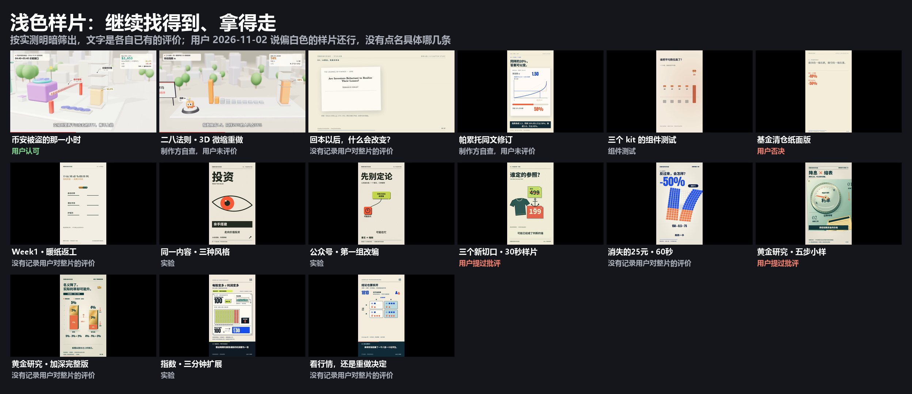

# 浅色样片的工程

用户 2026-11-02 说：“之前几个偏白色风格的样片，我觉得还行，希望保留并能继续找到、取用。”用户没有点名是哪几条，**所以放在这里不等于认可**，每条的评价写在各自的 README 开头，其中有被批评过的。



| 工程 | 片子 | 评价 |
|---|---|---|
| [revision](revision/README.md) | Week1 · 暖纸返工 | 没有记录用户对整片的评价 |
| [style-studies](style-studies/README.md) | 同一内容 · 三种风格 | 实验 |
| [article-studies](article-studies/README.md) | 公众号 · 第一组改编 | 实验 |
| [content-lab](content-lab/README.md) | 三个新切口 · 30秒样片 | 用户提过批评 |
| [disappearing25](disappearing25/README.md) | 消失的25元 · 60秒 | 没有记录用户对整片的评价 |
| [gold-proof](gold-proof/README.md) | 黄金研究 · 五步小样 | 用户提过批评 |
| [gold-full](gold-full/README.md) | 黄金研究 · 加深完整版 | 没有记录用户对整片的评价 |
| [index-machine](index-machine/README.md) | 指数 · 三分钟扩展 | 实验 |
| [decision-frequency](decision-frequency/README.md) | 看行情，还是重做决定 | 没有记录用户对整片的评价 |

其他浅色样片的工程本来就在仓库里：[币安](../binance-1029/README.md)、[二八法则](../pareto-diorama/README.md)、[回本以后](../chapter-01/README.md)、[帕累托同文修订](../pareto-revision/README.md)、[组件测试](../production-gates/)。[基金清仓纸面版](../failed-cases/R06-fund-paper/README.md)是用户否决的，放在失败工程里。

```sh
python scripts/samples.py list --tone light
python scripts/samples.py show gold-full
```

**入库范围（2026-11-02）：** 源码、稿件、证据和检查记录。视频一直在 `examples/gallery/media/`，各 README 开头有入口。

**没有入库的：**

- **文章全文。** 公众号正文和粘贴全文不公开，按文件名排除，再逐文件比对：连续照抄超过 500 字的文件也排除，排除了哪些写在各工程的 `archive.json`。旁白稿和字幕是改编后的文字，保留。
- **依赖、字体、配音和渲染产物。** 所以这些工程不能直接重新渲染，要补齐才能跑，重渲没有验证过。完整工程留在制作者本机，`archive.json` 记了相对路径。

部分工程复用了 weilanx 的组件，来源和 MIT 许可见 [NOTICE](../../NOTICE.md)。
