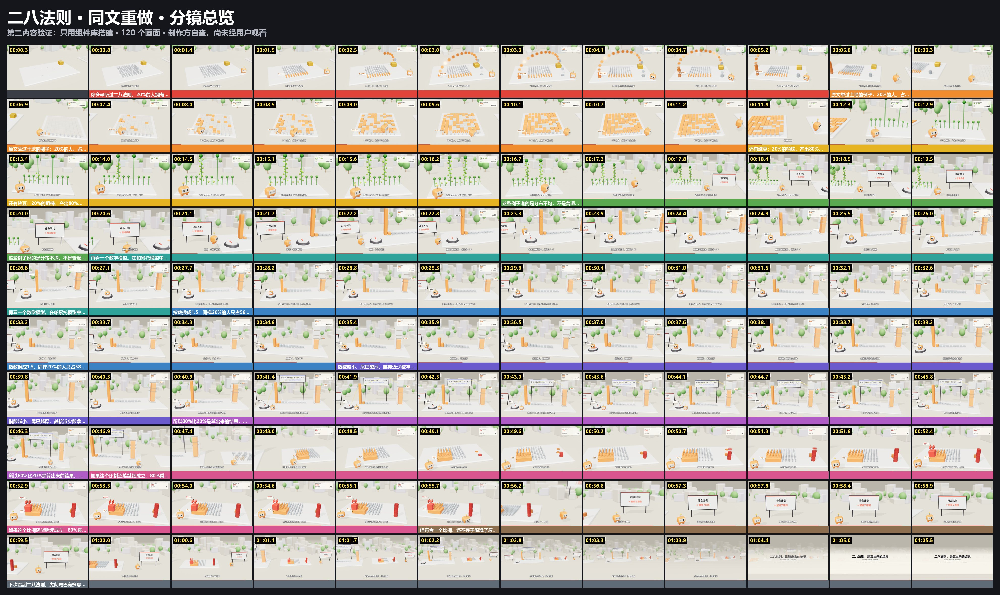
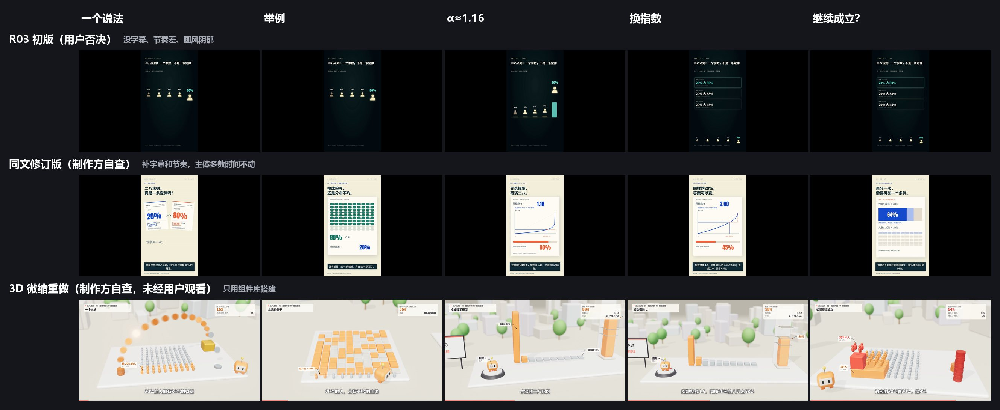

# 二八法则 · 同文 3D 微缩重做

**第二内容验证，制作方自查，用户还没看过。** 用来回答一个问题：币安那套做法能不能换题材？答案是能跑通，质量要等用户看。

[▶ 在线播放](https://ninglinliu.github.io/script-to-video-skill/examples/pareto-diorama/) · [720p 预览](media/preview.mp4) · [SRT](media/subtitles.srt)



稿件和 [examples/pareto-revision](../pareto-revision/README.md) 是同一篇，只按句拆开。这篇的初版就是被否决的 R03（"没字幕、节奏差、画风阴郁"），所以能直接对比动画差异。



## 这条验证了什么

- `web/scene.js` 只用 `stage`、`overlay`、`props`、`motion`，没有一行币安专用代码，换题材时组件够用。
- 新增了 `createCrowd`、`createBoard`、`createInstances`、`hopPath`，都已进组件库，币安版没有用到它们。
- 同一个 α 同时驱动旋钮、十档分布柱和份额柱：`0.2^(1−1/α)`，α≈1.161 时 80%，1.5 时 58.5%，2.0 时 44.7%。
- 改善了颜色：`createStage({hemi: .85, keyLight: 2.4, exposure: .8})`，比币安版饱和。

## 站点

| 旁白 | 站点 | 主体动作 → 结果 |
|---|---|---|
| L1 20% 拥有 80% | 村庄 | 100 人错峰站起，前两排变橙；50 枚币抛物线飞向两堆，40 比 10 |
| L2 土地 | 地块 | 小人一路跳过，100 块地里 80 块翻橙隆起 |
| L3 豌豆 | 植株 | 10 株错峰长高，2 株结 16 荚、8 株结 1 荚，正好 80% |
| L4 不是规律 | 立牌 | "分布不均 ≠ 普遍规律"从上方落下 |
| L5–L7 换指数 | 模型 | 小人跳上旋钮，旋钮转动，十档柱和份额柱一起变 |
| L8 算出来的 | 公式 | 公式牌落下，光束从旋钮连到份额柱 |
| L9 继续成立 | 人群 | 20 人升上台，其中 4 人再升；币堆长到 64% |
| L10–L11 | 立牌、全景 | "符合比例 ≠ 解释了原因"，镜头拉远看完整路径 |

## 观察到的弱点

- **27–40 秒**是最弱的一段。[分镜总览](../../docs/media/storyboard-pareto.jpg)第 5、6 行几乎一样：镜头基本不动，只有柱子变化和小人原地跳，主体区变化量也掉到 1 左右。
- 十档柱的"尾巴"不够直观：观众未必能把一排变矮的柱子和"尾巴变厚"对应起来。
- 公式牌在 3D 场景里偏小，手机上可能看不清。

技术：H.264 1920×1080/30fps，1974 帧，65.8 秒，完整解码无错误，音画对齐。这份仓库里放的是 720p 预览，1080p 原片留在本地。

## 复现

```sh
python scripts/diorama.py new --episode ./ep --source pareto-diorama
cd ep && npm install && node render.mjs setup
node render.mjs stills 9,19,31,54
```

来源：`source/source-manifest.json`（沿用 pareto-revision 的证据清单）和 `source/script.json` 每句的 `src`。
