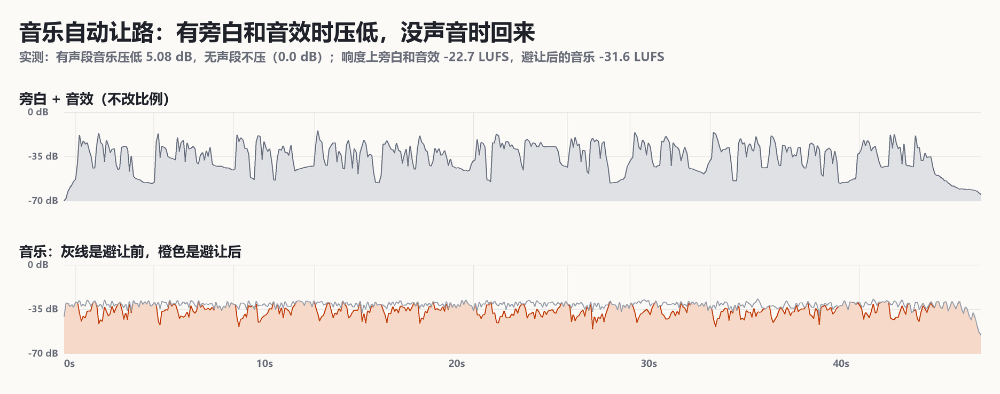

# 声音与素材

## 先辨认音乐来源

保留用户原链接。依次检查参考视频完整时长、平台music字段、音频文件实际时长与来源。music_title为“创作的原声”不代表它是无旁白的完整音乐。短视频剪辑的混合原声不能自动称作干净BGM，也不能仅据6秒下载文件断言原曲只有6秒。

优先复用本地已确认音乐。若只取得带旁白的片段，继续查找曲目/上游来源或向用户说明具体缺口；分离音源的输出应标为估计伴奏并检查残余人声，不伪装成官方母带。听音受用户静音约束时只做离线分析，注明未人工听音。

## 可复用混音命令

```sh
python scripts/mix_music.py --video /path/to/silent.mp4 --voice /path/to/voice.wav --music /path/to/music.mp3 --output /path/to/local-only/final-with-music.mp4 --report /path/to/local-only/music-mix.json
```

脚本默认拒绝音乐短于视频的情况。用户明确接受短循环时加`--allow-loop`，采用0.12秒交叉淡化；默认首尾淡入淡出、音乐-27LUFS、旁白侧链压低、总轨-16LUFS目标、AAC192kbps。参数是起点，不是听感保证；`--music-lufs`与`--crossfade`可调整。音乐足够长时不循环，不更改旁白语速。更换配乐保留原配音版和静音预览。

输出检查包含完整解码、实际响度、真峰值、原视频码流一致、输入音乐哈希、循环次数、未外放/未听音状态。不能凭峰值正常断言音乐合适、循环不突兀或配音表演优秀。

## 用户认可的配乐做法（2026-11-02）

用户听了[凯撒样片](../examples/caesar-ai-bubble/README.md)的两个配乐版本后说：“A「低频悬疑」配乐版我觉得 OK”，“认可范围是这次配乐效果”（R09）。下面是那一版的完整配方。**范围只到这次配乐：** 画面用户没有单独评价；换片、换旁白或换曲后参数只是起点，要重新给用户听。

### 选曲来源

| 项 | 内容 |
|---|---|
| 曲目 | [Crypto](https://incompetech.com/music/royalty-free/index.html?isrc=USUAN1600013)，Kevin MacLeod，ISRC USUAN1600013，80 BPM，长笛、打击乐、合成器 |
| 站点标注的感觉 | Dark, Eerie, Unnerving, Suspenseful |
| 来源 | 作者站点 incompetech.com 的完整曲目，204.07 秒，比片长 47.81 秒长得多，不循环 |
| 登记 | [assets/music/catalog.json](../assets/music/catalog.json) 记来源、SHA-256、授权和混音预设。音频不入库，`python scripts/music_library.py fetch <id> --out audio/music` 下载并校验 |
| 做法 | 按内容情绪选两首性格不同的完整曲目，各混一版给用户听。这次是 A 低频悬疑（Crypto）和 B 电子节奏（[Cipher](https://incompetech.com/music/royalty-free/index.html?isrc=USUAN1100844)），用户选了 A。B 没有被否决，只是这条片没选 |

不用短视频平台的“原声”，也不用参考片的音轨。理由见经验卡 E14。

### 授权署名

CC BY 4.0，[作者站点 FAQ](https://incompetech.com/music/royalty-free/faq.html) 写明全部音乐按此授权并给出署名格式。可以商用，**但必须署名**，署名要让人找得到，放视频简介或片内都行；如果改动了素材，要在署名里说清楚。署名由工具生成，不要手抄：

```text
"Crypto" Kevin MacLeod (incompetech.com)
Licensed under Creative Commons: By Attribution 4.0
https://creativecommons.org/licenses/by/4.0/
Music trimmed, loudness-normalized, faded and ducked beneath narration and sound effects.
```

```sh
python scripts/music_library.py credit crypto-kevin-macleod    # 打印署名
```

**发布前必须把这段放进简介或片尾。** 被认可的这版成片画面里没有烧署名，所以这一步不能省。

### 旁白与音效保留

先把旁白和音效混成一轨（`assets/diorama-kit/sfx.py` 输出 `audio/mix.wav`，音效压在旁白下面约 14 dB），再整轨传给 `--voice`。配乐阶段不改它们之间的比例，不改语速，也不重编码画面。工具用码流哈希核对画面没变。

### 音乐自动避让

用 `--voice` 整轨作侧链键，所以旁白和音效响起时音乐都会让路，安静时回来。不用手画音量曲线。

| 参数 | 值 |
|---|---|
| 滤镜 | `sidechaincompress` |
| threshold / ratio | 0.035 / 8 |
| attack / release | 15 ms / 350 ms |

这一版的实测：有声段音乐压低 5.08 dB，无声段不压（0.0 dB）；旁白和音效 −22.7 LUFS，音乐避让前 −28.9、避让后 −31.6 LUFS。两者相差约 9 dB。低频音乐的能量集中在低频，只看 RMS 差（6.49 dB）会低估人声比音乐清楚的程度，所以报告同时给 LUFS。



### 淡入淡出和响度

| 环节 | 参数 | A 版取值 | 说明 |
|---|---|---|---|
| 音乐目标响度 | `loudnorm I` | **−29 LUFS** | 比工具默认的 −27 低 2 dB；B 版 Cipher 是 −30 |
| 音乐峰值和动态 | `TP` / `LRA` | −9 dBTP / 7 | 给旁白留出余量 |
| 音乐长度 | `atrim` | 取片头起的 47.81 秒 | 不循环，不跳段 |
| 淡入 | `afade in` | 0.25 秒 | 只作用在音乐 |
| 淡出 | `afade out` | 1.2 秒 | 片尾最后 1.2 秒 |
| 混合 | `amix normalize=0` | — | 不自动压低旁白 |
| 总轨 | `loudnorm I/TP/LRA` | −16 LUFS / −1.5 dBTP / 7 | 实测 −16.63 LUFS，真峰值 −1.44 dBTP |
| 编码 | AAC | 192 kbps，48 kHz | 视频流复制 |

### 一条命令

```sh
python scripts/music_library.py fetch crypto-kevin-macleod --out audio/music
python scripts/mix_music.py --video out/final.mp4 --voice audio/mix.wav --music audio/music/Crypto.mp3 \
  --track crypto-kevin-macleod --output out/final-music.mp4 --report out/mix.json --credit-out out/music-credit.txt
```

`--track` 校验音乐哈希、套用曲目预设，并把署名写进报告和 `--credit-out`。不带 `--track` 时行为和以前一样，默认 −27 LUFS。`--music-lufs`、`--fade-in`、`--fade-out` 可覆盖预设。报告旁边的 `.levels.json` 是逐 0.1 秒电平，可以用来画避让图。

### 怎么验证，验证到哪一步

用同一输入重跑配方，和认可成片比对：视频流完全一致；音频只在最后约 1.4 秒（46.4 秒之后）有差异，整体差 −83.6 dBFS。原因是 ffmpeg 收尾时 `apad` 与 `loudnorm` 前瞻的调度不确定，机器负载不同结果会变，高负载下曾跑出与认可成片逐字节相同的文件。所以**这组参数就是 A 版的配方，但不要用整文件哈希判断配方是否改动**，要比视频流哈希和响度报告。

工具和 Agent 都没有听过声音（报告里 `manualListening=false`）。“音乐合不合适”只来自用户试听，测量值只能说明避让发生了、响度在目标附近。换片时仍然做 A/B 给用户听，试听页和两版报告的写法见[案例](../examples/caesar-ai-bubble/README.md)。

## 纯音乐片（2026-11-09）

临界点风格只有音乐，没有旁白和音效可以避让。`mix_music.py` 不传 `--voice` 就走这条：

| 参数 | 默认 |
|---|---|
| 总轨响度 | −14 LUFS，真峰值 −1.5 dBTP，LRA 7（`--master-lufs` 可改） |
| 淡入 / 淡出 | 0.5 秒 / 3 秒 |
| 避让 | 不做；报告里 `musicOnly: true`、`ducking: null` |
| 署名的改动说明 | “Music trimmed, loudness-normalized and faded.”，`music_library.py credit <id> --music-only` 打印 |

参考片整合响度约 −9.4 LUFS，偏响；这里取 −14，平台会再做响度均衡。凯利样片按这个做了 A（Stay the Course）、B（Crypto）两版，**用户还没听**，所以这组参数还不算认可过。

## 本地包与公开包

每项素材写明路径、来源、用途、许可和分发范围。用户批准推送不把第三方字体、音乐、论文和参考视频改成MIT。OFL字体附许可证；第三方有限题头引用单独归属。未取得再分发许可的参考配乐只留本地，公开包保存来源与导入命令。公开包不含完整公众号原文或论文缓存、Cookie、登录令牌、机器路径。

静音预览采用实际无音轨文件、默认暂停。有声版本以明确下载/播放入口提供，不自动外放。更新本地交付时同步文件清单、配乐出处、混音报告；不要让旧审查哈希冒充新混音文件的审查。
